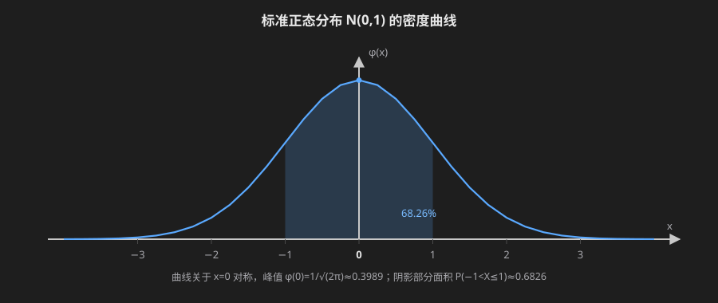
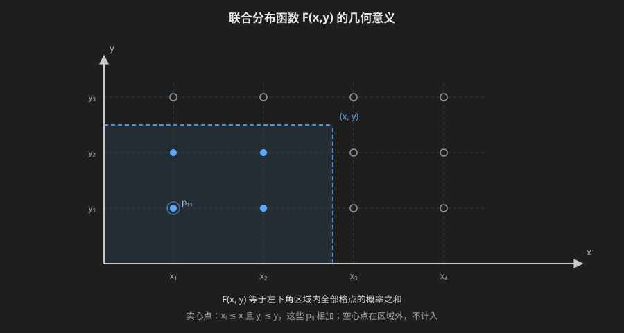
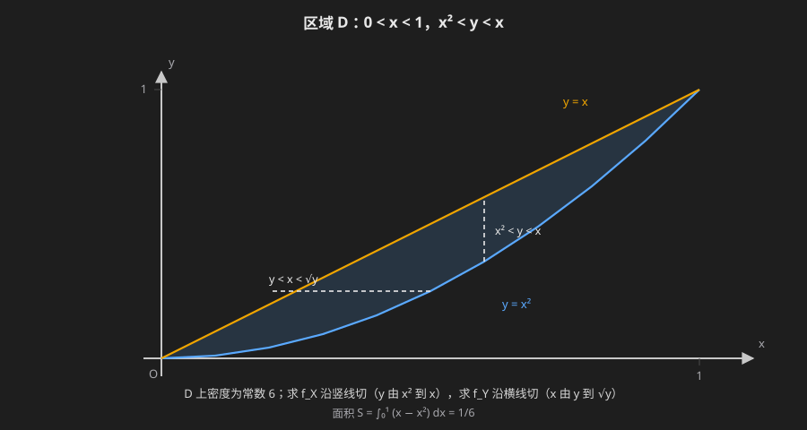

# 预备知识

## 加法原理

**完成一件事有$k$类互不重叠的方式,第$i$类方式有$m_i$种方法,则完成这件事共有$m_1+m_2+\cdots+m_k$种方法**

$$
m_1+m_2+\cdots+m_k
$$

+ 要点是"分类":各类方式互斥,任取一类中的一种方法即可独立完成整件事
+ 例:从甲地到乙地,火车有3班、汽车有2班、飞机有1班,共有$3+2+1=6$种走法

## 乘法原理

**完成一件事需依次经过$k$个步骤,第$i$步有$m_i$种方法,则完成这件事共有$m_1m_2\cdots m_k$种方法**

$$
m_1m_2\cdots m_k
$$

+ 要点是"分步":缺任何一步都不能完成,各步方法数相乘
+ 例:从甲地经乙地到丙地,甲到乙有3条路,乙到丙有2条路,共有$3\times2=6$种走法

## 排列

**从$n$个不同元素中任取$m$个($m\le n$),按一定顺序排成一列,称为排列,其个数记为$A_n^m$**

$$
A_n^m=n(n-1)\cdots(n-m+1)=\frac{n!}{(n-m)!}
$$

+ 全排列:当$m=n$时$A_n^n=n!$,并规定$0!=1$
+ 排列的关键是"有序":交换两个元素的位置,得到的是不同的排列
+ 例:从$1,2,3,4$中任取3个排成三位数,共有$A_4^3=4\times3\times2=24$个
+ 可重复排列:从$n$个不同元素中每次取一个,允许重复地取$m$次并按顺序排列,共有$n^m$种
  + 例:三位数字密码锁的每一位可取$0\sim9$,共有$10^3=1000$种密码
  + 例:$n$个人各自等可能地走进$N$个房间中的一个,共有$N^n$种进法

## 组合

**从$n$个不同元素中任取$m$个($m\le n$),不考虑顺序地组成一组,称为组合,其个数记为$C_n^m$**

$$
C_n^m=\frac{A_n^m}{m!}=\frac{n!}{m!\,(n-m)!}
$$

+ 组合的关键是"无序":只关心取出了哪些元素,不关心取出的先后
+ 排列与组合的关系:$A_n^m=C_n^m\cdot m!$,即先选出$m$个元素,再对这$m$个元素作全排列
+ 例:从10人中选3人组成小组,共有$C_{10}^3=\frac{10\times9\times8}{3\times2\times1}=120$种;若这3人分别担任正、副、组长,则共有$A_{10}^3=10\times9\times8=720$种

## 常用组合恒等式

+ $C_n^m=C_n^{\,n-m}$
+ $C_n^0=C_n^n=1$
+ $C_n^m=C_{n-1}^{m-1}+C_{n-1}^{m}$
+ $C_n^0+C_n^1+\cdots+C_n^n=2^n$
+ 二项式定理:$(a+b)^n=\sum\limits_{m=0}^{n}C_n^m\,a^m b^{\,n-m}$

# 随机事件及其概率

## 随机试验与随机事件

### 随机试验

在相同条件下可以重复进行的试验,且每次试验的结果事先无法确定,这样的试验叫做随机试验

+ 随机试验的三个特点
  + 可在相同条件下重复进行
  + 每次试验可能出现的结果不止一个,且所有可能结果事先已知
  + 每次试验前无法确定会出现哪个结果
+ 例子:抛一枚硬币、掷一枚骰子、从一批产品中抽一件检验

### 样本空间与样本点

**随机试验的所有可能结果组成的集合叫做样本空间,记为$\Omega$**

样本空间中的每一个元素,即每个可能结果,叫做样本点

+ 抛硬币:$\Omega=\{正,反\}$
+ 掷骰子:$\Omega=\{1,2,3,4,5,6\}$
+ 样本空间按所含样本点的多少分为有限、可列无限与不可列无限三类

### 随机事件

**样本空间的子集叫做随机事件,简称事件,常用大写字母$A,B,C,\dots$表示**

+ 基本事件:只含一个样本点的事件(单个样本点组成)
+ 必然事件:每次试验都必然发生的事件,即样本空间$\Omega$本身
+ 不可能事件:每次试验都不可能发生的事件,即空集$\varnothing$

### 事件之间的关系与运算

+ 包含:若事件$A$发生则$B$一定发生,称$A$包含于$B$,记为$A\subset B$
+ 相等:若$A\subset B$且$B\subset A$,则$A=B$
+ 和事件:$A\cup B$,事件$A$与$B$至少有一个发生
+ 积事件:$A\cap B$($AB$),事件$A$与$B$同时发生
+ 差事件:$A-B$,事件$A$发生而$B$不发生
+ 互不相容(互斥):$AB=\varnothing$,事件$A$与$B$不能同时发生
+ 对立事件:若$A\cup B=\Omega$且$AB=\varnothing$,则称$B$为$A$的对立事件(逆事件),记为$\overline{A}$
+ 完备事件组:若$A_1,A_2,\dots,A_n$两两互不相容,且$A_1\cup A_2\cup\dots\cup A_n=\Omega$,则称其为完备事件组

### 事件运算律

+ 交换律:$A\cup B=B\cup A,\quad A\cap B=B\cap A$
+ 结合律:$A\cup(B\cup C)=(A\cup B)\cup C,\quad A\cap(B\cap C)=(A\cap B)\cap C$
+ 分配律:$A\cup(B\cap C)=(A\cup B)\cap(A\cup C),\quad A\cap(B\cup C)=(A\cap B)\cup(A\cap C)$
+ 德摩根律(对偶律):$\overline{A\cup B}=\overline{A}\cap\overline{B},\quad\overline{A\cap B}=\overline{A}\cup\overline{B}$

## 频率与概率

### 频率

**在相同条件下进行$n$次试验,事件$A$发生的次数$n_A$称为$A$的频数,比值$f_n(A)=\frac{n_A}{n}$称为事件$A$发生的频率**

+ 频率的性质
  + 非负性:$0\le f_n(A)\le 1$
  + 规范性:$f_n(\Omega)=1$
  + 有限可加性:若$A_1,A_2,\dots,A_k$两两互不相容,则$f_n(A_1\cup A_2\cup\dots\cup A_k)=f_n(A_1)+f_n(A_2)+\dots+f_n(A_k)$
+ 这三条性质与概率的三条公理一一对应;区别在于频率依赖试验结果,是随试验而变的量,概率是客观常数

**频率的稳定性**:试验次数$n$很大时,频率$f_n(A)$围绕某一常数$p$作幅度越来越小的摆动,即$f_n(A)\approx p$

### 概率的统计定义

**在相同条件下大量重复试验,若事件$A$的频率$f_n(A)$稳定地在某一常数$p$附近摆动,则称$p$为事件$A$的概率,记为$P(A)=p$**

+ 这种定义称为概率的统计定义(频率定义):概率是频率的稳定值,频率是概率的近似值,$n$越大$f_n(A)$越接近$P(A)$
+ 局限:试验次数不可能无限增大,稳定值$p$无法精确得到,只能得到近似值;严格说来它不是数学定义,概率的严格定义是公理化定义

### 概率的公理化定义

**设$\Omega$为样本空间,对$\Omega$中的每一个事件$A$赋予一个实数$P(A)$,若满足下列三条公理,则称$P(A)$为事件$A$的概率**

+ 公理1(非负性):$P(A)\ge 0$
+ 公理2(规范性):$P(\Omega)=1$
+ 公理3(可列可加性):若$A_1,A_2,\dots$两两互不相容,则

$$
P\left(\bigcup_{i=1}^{\infty}A_i\right)=\sum_{i=1}^{\infty}P(A_i)
$$

+ 公理化定义只规定概率应满足的性质,不给出具体算法;具体算法由不同的概率模型(古典概型、几何概型等)提供

### 概率的性质

**由三条公理推出的常用性质**

+ $0\le P(A)\le 1$,$P(\varnothing)=0$
+ 不可能事件的概率为零;反之不成立,$P(A)=0$不能推出$A$不可能发生
+ 有限可加性:若$A_1,A_2,\dots,A_n$两两互不相容,则$P\left(\bigcup_{i=1}^{n}A_i\right)=\sum_{i=1}^{n}P(A_i)$
+ 对立事件公式:$P(\overline{A})=1-P(A)$
+ 减法公式:$P(A-B)=P(A)-P(AB)$;特别地,当$B\subset A$时$P(A-B)=P(A)-P(B)$
+ 单调性:若$A\subset B$,则$P(A)\le P(B)$
+ 加法公式:$P(A\cup B)=P(A)+P(B)-P(AB)$
+ 三个事件的加法公式:

$$
P(A\cup B\cup C)=P(A)+P(B)+P(C)-P(AB)-P(AC)-P(BC)+P(ABC)
$$

+ $n$个事件的加法公式(容斥原理):

$$
P\left(\bigcup_{i=1}^{n}A_i\right)=\sum_{i}P(A_i)-\sum_{i<j}P(A_iA_j)+\sum_{i<j<k}P(A_iA_jA_k)-\cdots+(-1)^{n-1}P(A_1A_2\cdots A_n)
$$

## 古典概型与几何概型

### 古典概型

+ 有限性：样本空间只含有限个样本点
+ 等可能性：每个样本点出现的可能性相同,则称该试验为古典概型(等可能概型)
+ 设$\Omega=\{\omega_1,\omega_2,\dots,\omega_n\}$,则每个样本点的概率为$P(\omega_i)=\frac{1}{n}$;对任意事件$A$有

$$
P(A)=\frac{A\text{所含样本点数}}{\Omega\text{中样本点总数}}=\frac{k}{n}
$$

**典型模型**

+ 摸球模型:袋中有$m$个白球、$n-m$个黑球,从中任取$k$个(无放回),则恰有$j$个白球的概率为

$$
P=\frac{C_m^j\,C_{n-m}^{k-j}}{C_n^k}
$$

+ 例:袋中4白6红,任取3个,求恰有2白1红的概率:$P=\frac{C_4^2C_6^1}{C_{10}^3}=\frac{6\times6}{120}=\frac{3}{10}$
+ 有放回时样本点总数为$n^k$,概率变为二项分布的形式(后面再讲)
+ 抽签模型:$n$支签中只有1支中奖,第$k$个人抽中的概率与$k$无关,均为$\frac{1}{n}$
  + 说明"先抽后抽机会均等",即古典概型中顺序不影响概率
+ 分房模型:$n$个人各自等可能地进入$N$个房间中的一间,每间可住任意多人,则指定的某一间恰有$k$人的概率为

$$
P=\frac{C_n^k\,(N-1)^{n-k}}{N^n}
$$

+ 生日问题:$n$个人中至少有两人生日相同的概率为

$$
P=1-\frac{365\times364\times\cdots\times(365-n+1)}{365^n}
$$

+ $n=50$时$P\approx 0.97$;当$n\ge 366$时$P=1$(抽屉原理)

### 几何概型

**若随机试验的样本空间是某个可度量的几何区域$\Omega$(线段、平面区域、空间体),且样本点等可能地落在$\Omega$内任意位置,则称该试验为几何概型**

+ 两条特征:无限性(样本点有无限多个)与等可能性(落在等测度子区域的可能性相同)
+ 概率只与区域的测度成正比,与区域的位置、形状无关

$$
P(A)=\frac{m(A)}{m(\Omega)}
$$

其中$m(\cdot)$表示长度、面积或体积

+ 与古典概型的区别:古典概型"有限个样本点,按个数比",几何概型"无限个样本点,按测度比";共同点都要求等可能

## 条件概率与乘法公式

### 条件概率

**设$A,B$为两个事件,且$P(A)>0$,则称**

$$
P(B\mid A)=\frac{P(AB)}{P(A)}
$$

**为在事件$A$发生的条件下事件$B$发生的条件概率**

+ 直观理解:条件概率是把样本空间压缩到$A$之内,以$A$为新的样本空间重新计算$B$发生的概率
+ 条件概率仍是概率:固定$A$后,$P(\cdot\mid A)$满足三条公理,故概率的一切性质对它都成立
  + $P(B\mid A)\ge 0$,$\;P(\Omega\mid A)=1$
  + $P(\overline{B}\mid A)=1-P(B\mid A)$
  + $P(B\cup C\mid A)=P(B\mid A)+P(C\mid A)-P(BC\mid A)$
+ 条件概率与无条件概率没有固定的大小关系,$P(B\mid A)$可能大于、小于或等于$P(B)$
+ 例:掷一枚骰子,$A=\{2,4,6\}$,$B=\{4,5,6\}$,则$P(B\mid A)=\frac{P(AB)}{P(A)}=\frac{2/6}{3/6}=\frac{2}{3}$,而$P(B)=\frac{1}{2}$
+ 注意:$P(B\mid A)$是"已知$A$发生"时$B$的概率,与"$A,B$同时发生"的概率$P(AB)$不同;若$A\subset B$,则$P(B\mid A)=1$

### 乘法公式

**由条件概率的定义式直接变形,得乘法公式;它把"同时发生"的概率拆成条件概率的乘积**

+ 两个事件:若$P(A)>0$,则
$$
P(AB)=P(A)P(B\mid A)
$$
+ 三个事件:若$P(AB)>0$,则

$$
P(ABC)=P(A)P(B\mid A)P(C\mid AB)
$$

+ $n$个事件:若$P(A_1A_2\cdots A_{n-1})>0$,则

$$
P(A_1A_2\cdots A_n)=P(A_1)P(A_2\mid A_1)P(A_3\mid A_1A_2)\cdots P(A_n\mid A_1A_2\cdots A_{n-1})
$$

+ 用途:多步骤试验、无放回抽样等"依次发生"的问题,用乘法公式逐层递推
+ 例:袋中4白6红,无放回地取3个球,求3个都是白球的概率

$$
P=\frac{4}{10}\cdot\frac{3}{9}\cdot\frac{2}{8}=\frac{1}{30}
$$

  + 验证:$\frac{C_4^3}{C_{10}^3}=\frac{4}{120}=\frac{1}{30}$
+ 例(抽签的对称性):10人依次抽1张中奖签,求第$k$个人中奖的概率
  + 前$k-1$人都未抽中且第$k$人抽中,用乘法公式

$$
P=\frac{9}{10}\cdot\frac{8}{9}\cdot\frac{7}{8}\cdots\frac{10-k+1}{10-k+2}\cdot\frac{1}{10-k+1}=\frac{1}{10}
$$

  + 说明先抽后抽机会均等,与上一节抽签模型的结论一致
+ 注意:乘法公式的条件$P(A)>0$($n$个事件时为$P(A_1A_2\cdots A_{n-1})>0$)不可省略;若某个条件概率的分母为零,公式无意义

### 全概率公式与贝叶斯公式

**若事件组$B_1,B_2,\dots,B_n$两两互不相容,且$B_1\cup B_2\cup\cdots\cup B_n=\Omega$,则称它为样本空间的一个划分**

+ 划分把$\Omega$切成互不重叠的若干块,任一事件$A$随之被拆成互不相容的几块:$A=AB_1\cup AB_2\cup\cdots\cup AB_n$
+ 全概率公式与贝叶斯公式都以划分为前提,并要求$P(B_i)>0$,否则条件概率$P(A\mid B_i)$没有意义

**全概率公式**:设$B_1,B_2,\dots,B_n$为$\Omega$的一个划分,且$P(B_i)>0,i=1,2,\dots,n$,则对任意事件$A$有

$$
P(A)=\sum_{i=1}^{n}P(B_i)P(A\mid B_i)
$$

+ 例:某厂甲、乙、丙三条生产线的产量分别占全厂的$25\%$、$35\%$、$40\%$,次品率分别为$5\%$、$4\%$、$2\%$,求任取一件是次品的概率
  + 记$A$为"取到次品",$B_1,B_2,B_3$分别为"取自甲、乙、丙线",则$B_1,B_2,B_3$是一个划分

$$
P(A)=0.25\times0.05+0.35\times0.04+0.40\times0.02=0.0345
$$

**贝叶斯公式**:设$B_1,B_2,\dots,B_n$为$\Omega$的一个划分,$P(B_i)>0$,且$P(A)>0$,则

$$
P(B_i\mid A)=\frac{P(B_i)P(A\mid B_i)}{\sum\limits_{j=1}^{n}P(B_j)P(A\mid B_j)},\quad i=1,2,\dots,n
$$

+ 例(续上):已知取到的一件是次品,求它来自甲生产线的概率

$$
P(B_1\mid A)=\frac{0.25\times0.05}{0.0345}=\frac{0.0125}{0.0345}\approx 0.362
$$

  + 验证:$P(B_2\mid A)=\frac{0.014}{0.0345}\approx 0.406$,$P(B_3\mid A)=\frac{0.008}{0.0345}\approx 0.232$,三者之和为$1$
+ 注意:甲线产量只占$25\%$,但在已知是次品的条件下升至约$36.2\%$,因为它的次品率最高,结果把对原因的判断修正了

### 事件的独立性和伯努利试验

**设$A,B$为两个事件,若$P(AB)=P(A)P(B)$,则称事件$A$与事件$B$相互独立,简称独立**

+ 等价说法:当$P(A)>0$时,$A,B$独立$\iff P(B\mid A)=P(B)$;当$P(B)>0$时,$A,B$独立$\iff P(A\mid B)=P(A)$,即一个事件发生与否不影响另一个事件发生的概率
+ 与互不相容的区别:互不相容指$AB=\varnothing$,独立指$P(AB)=P(A)P(B)$;当$P(A)>0,P(B)>0$时,互不相容必有$P(AB)=0\ne P(A)P(B)$,故互不相容一定不独立,独立也一定不互不相容
+ 性质:若$A,B$独立,则$A$与$\overline{B}$、$\overline{A}$与$B$、$\overline{A}$与$\overline{B}$也都独立,即这四对中有一对独立,其余三对都独立
+ 判定:实际问题中通常按试验的含义直接认定独立性(如两人独立破译、各台机器独立运行);含义不明时才用公式$P(AB)=P(A)P(B)$验证

**三个事件相互独立**:若$A,B,C$满足

$$
P(AB)=P(A)P(B),\quad P(AC)=P(A)P(C),\quad P(BC)=P(B)P(C),\quad P(ABC)=P(A)P(B)P(C)
$$

**则称$A,B,C$相互独立;只有前三个等式成立时,只称它们两两独立**

+ 注意:两两独立推不出相互独立,四个等式缺一不可
+ 反例:取$\Omega=\{\omega_1,\omega_2,\omega_3,\omega_4\}$为四个等可能的样本点,$A=\{\omega_1,\omega_2\}$,$B=\{\omega_1,\omega_3\}$,$C=\{\omega_1,\omega_4\}$,则$P(AB)=P(AC)=P(BC)=\frac{1}{4}=P(A)P(B)$,三个事件两两独立,但$P(ABC)=\frac{1}{4}\ne\frac{1}{8}=P(A)P(B)P(C)$
+ $n$个事件相互独立:对任意$k=2,3,\dots,n$及任意$k$个事件$A_{i_1},A_{i_2},\dots,A_{i_k}$,都有

$$
P(A_{i_1}A_{i_2}\cdots A_{i_k})=P(A_{i_1})P(A_{i_2})\cdots P(A_{i_k})
$$

  + 性质:若$A_1,A_2,\dots,A_n$相互独立,则把其中任意几个换成对立事件,所得的$n$个事件仍相互独立
  + 应用:若$A_1,A_2,\dots,A_n$相互独立,则$P(A_1\cup A_2\cup\cdots\cup A_n)=1-\prod_{i=1}^{n}\left[1-P(A_i)\right]$

+ $P(A)=0$或$P(A)=1$时,$A$与任何事件都独立

**伯努利试验**:若试验$E$只有两个可能结果$A$与$\overline{A}$,且$P(A)=p$($0<p<1$),将$E$独立重复地进行$n$次,则称这$n$次试验为$n$重伯努利试验

+ 三个条件:每次试验只有两个可能结果;各次试验相互独立;每次试验中$P(A)=p$保持不变

**二项概率公式**:在$n$重伯努利试验中,事件$A$恰好发生$k$次的概率为

$$
P_n(k)=C_n^k\,p^k(1-p)^{n-k},\quad k=0,1,\dots,n
$$

# 随机变量及其分布

## 随机变量

**设随机试验的样本空间为$\Omega$,若对每个样本点$\omega\in\Omega$都有唯一实数$X(\omega)$与之对应,则称$X=X(\omega)$为随机变量**

+ 随机变量是定义在样本空间上的实值函数,它的取值随试验结果而变,且以一定的概率取各个值
+ 引入随机变量后,"$X$取某个值"或"$X$落在某个区间"这类事件就是$\Omega$的子集
+ 约定:随机变量用大写字母$X,Y,Z$表示,其取值用小写字母$x,y,z$表示
+ 按取值特点分两类:取值为有限个或可列无限个的称离散型随机变量;取值可充满某个区间的称连续型随机变量

## 概率分布

**随机变量的所有可能取值及其对应概率的全体,称为该随机变量的概率分布**

+ 离散型随机变量用分布律描述:若$X$的可能取值为$x_1,x_2,\dots$,则

$$
P(X=x_k)=p_k,\quad k=1,2,\dots
$$

+ 分布律的两条性质:$p_k\ge0$;$\sum\limits_{k}p_k=1$。反之,满足这两条的一列$p_k$必定是某个离散型随机变量的分布律
+ 连续型随机变量取值为不可列无限个,不能用分布律,改用概率密度描述

## 01分布，二项分布，泊松分布，超几何分布

### 0-1分布

**若$X$只取$0$与$1$两个值,且$P(X=1)=p$,$P(X=0)=1-p$($0<p<1$),则称$X$服从0-1分布,记作$X\sim B(1,p)$**

+ 它描述一次伯努利试验中事件发生与否,是最简单的离散型分布

### 二项分布

**在$n$重伯努利试验中,记$X$为事件$A$发生的次数,则$X$的分布律为**

$$
P(X=k)=C_n^k\,p^k(1-p)^{n-k},\quad k=0,1,\dots,n
$$

+ 记作$X\sim B(n,p)$,其中$p$为每次试验中$A$发生的概率
+ $n=1$时$B(1,p)$即0-1分布,故二项分布是0-1分布的推广

### 泊松分布

**若$X$的分布律为**

$$
P(X=k)=\frac{\lambda^k}{k!}e^{-\lambda},\quad k=0,1,2,\dots
$$

+ 其中$\lambda>0$为参数,记作$X\sim\pi(\lambda)$;它描述单位时间(或单位面积、体积)内稀有事件发生的次数
+ 泊松定理:当$n$很大、$p$很小,而$\lambda=np$大小适中时

$$
C_n^k\,p^k(1-p)^{n-k}\approx\frac{\lambda^k}{k!}e^{-\lambda}
$$

  + 即此时二项分布可用泊松分布近似;实际中$n\ge20$、$p\le0.05$时近似已较好

### 超几何分布

**设$N$件产品中有$M$件次品,从中不放回地任取$n$件,记取到的次品数为$X$,则**

$$
P(X=k)=\frac{C_M^k\,C_{N-M}^{n-k}}{C_N^n},\quad k=0,1,\dots,\min(n,M)
$$

+ 记作$X\sim H(N,M,n)$;它与二项分布的区别只在抽样是否放回,放回时为二项分布,不放回时为超几何分布
+ 当$N$很大而$n$相对很小时,超几何分布近似于二项分布$B\left(n,\dfrac{M}{N}\right)$

## 随机变量的分布函数

**设$X$为随机变量,$x$为任意实数,称函数**

$$
F(x)=P(X\le x),\quad -\infty<x<+\infty
$$

**为$X$的分布函数**

+ 分布函数是普通的实函数,定义域为$(-\infty,+\infty)$,值域为$[0,1]$
+ 三条基本性质:
	+ 单调不减,即$x_1<x_2$时$F(x_1)\le F(x_2)$;
	+ $F(-\infty)=0$,$F(+\infty)=1$;
	+ $F(x)$右连续,即$F(x+0)=F(x)$
+ 用分布函数求概率

$$
P(a<X\le b)=F(b)-F(a),\qquad P(X>a)=1-F(a)
$$

+ 离散型:$F(x)=\sum\limits_{x_k\le x}p_k$,是阶梯函数,在$x_k$处跳跃,跃度恰为$p_k$
+ 连续型:$F(x)$处处连续,且$F(x)=\int_{-\infty}^{x}f(t)\,dt$

## 连续型随机变量及其密度函数

**$x$为连续型随机变量，存在非负可积函数$f(x)>=0$,$\forall a<=b$**

$$
P(a<x<=b)=\int_{a}^{b}f(x)\,dx
$$
$f(x)$为概率分布密度函数

**若存在非负可积函数$f(x)$,使随机变量$X$的分布函数对任意实数$x$都有**

$$
F(x)=\int_{-\infty}^{x}f(t)\,dt
$$

**则称$X$为连续型随机变量,称$f(x)$为$X$的概率密度函数**

+ 概率密度函数的两条性质:
	+ $f(x)\ge0$
	+ $\int_{-\infty}^{+\infty}f(x)\,dx=1$
	+ 反之,满足这两条的函数都可作某个连续型随机变量的密度
+ 用密度求概率:$P(a<X\le b)=\int_a^b f(x)\,dx$,即密度曲线下区间$[a,b]$上的曲边梯形面积
+ 连续型随机变量取任一指定值的概率为零,即$P(X=a)=0$,故开区间、闭区间、半开区间上的概率都相同
+ 在$f(x)$的连续点处有$F'(x)=f(x)$,即密度是分布函数的导数
+ 注意:$f(x)$本身不是概率,$f(x)$的取值可以大于$1$;只有积分$\int_a^b f(x)\,dx$才表示概率

## 均匀分布，指数分布，正态分布

### 均匀分布

**若$X$的密度为**

$$
f(x)=\begin{cases}\dfrac{1}{b-a}, & a<x<b\\ 0, & \text{其他}\end{cases}
$$

+ 记作$X\sim U(a,b)$;其含义是$X$落在$(a,b)$内任一子区间的概率只与该子区间的长度成正比,与子区间的位置无关
+ 分布函数为

$$
F(x)=\begin{cases}0, & x<a\\ \dfrac{x-a}{b-a}, & a\le x<b\\ 1, & x\ge b\end{cases}
$$

### 指数分布

**若$X$的密度为**

$$
f(x)=\begin{cases}\lambda e^{-\lambda x}, & x>0\\ 0, & x\le0\end{cases}
$$

+ 其中$\lambda>0$,记作$X\sim E(\lambda)$;分布函数为$F(x)=1-e^{-\lambda x}$($x>0$)
+ 无记忆性:对任意$s,t>0$有

$$
P(X>s+t\mid X>s)=P(X>t)
$$

  + 即已使用$s$时间后再继续使用$t$时间的概率,与从头开始使用$t$时间的概率相同;指数分布是唯一具有无记忆性的连续型分布

### 正态分布

**若$X$的密度为**

$$
f(x)=\frac{1}{\sqrt{2\pi}\,\sigma}e^{-\frac{(x-\mu)^2}{2\sigma^2}},\quad -\infty<x<+\infty
$$

其中$\mu,\sigma$为参数且$\sigma>0$,记作$X\sim N(\mu,\sigma^2)$;密度曲线关于$x=\mu$对称,在$x=\mu$处取最大值,$\sigma$越小曲线越陡峭、取值越集中

#### 标准正态分布

$\mu=0,\sigma=1$时称为$N(0,1)$
其分布函数记作$\Phi(x)$;
其密度为

$$
\varphi(x)=\frac{1}{\sqrt{2\pi}}e^{-\frac{x^2}{2}},\quad -\infty<x<+\infty
$$
由对称性得
+ $\varphi(-x) = \varphi(x)$
+ $\Phi(-x)=1-\Phi(x)$
+ $P(a<X\le b)=\Phi\left(\frac{b-\mu}{\sigma}\right)-\Phi\left(\frac{a-\mu}{\sigma}\right)$
+ $P \{|X|<=x\} = 2\Phi(x)-1$

#### 一般正态分布向标准正态分布转换

+ $f(x) = \dfrac{1}{\sigma}\varphi\left(\dfrac{x-\mu}{\sigma}\right)$
+ $F(x) = \Phi\left(\dfrac{x-\mu}{\sigma}\right)$
$3\sigma$原则:$P(\mu-\sigma<X\le\mu+\sigma)\approx0.6826$,$P(\mu-2\sigma<X\le\mu+2\sigma)\approx0.9544$,$P(\mu-3\sigma<X\le\mu+3\sigma)\approx0.9974$

# 多维随机变量及其分布

## 二维离散型的概率分布

**若二维随机变量$(X,Y)$的全部可能取值为有限对或可列无限对$(x_i,y_j)$,则称$(X,Y)$为二维离散型随机变量**

+ 联合分布律:记$(X,Y)$取$(x_i,y_j)$的概率为

$$
P(X=x_i,\ Y=y_j)=p_{ij},\quad i,j=1,2,\dots
$$

+ 联合分布律的两条性质:$p_{ij}\ge0$;$\sum\limits_{i}\sum\limits_{j}p_{ij}=1$。反之,满足这两条的一族$p_{ij}$必定是某个二维离散型随机变量的联合分布律
+ 联合分布律可列成二维表:行取$X$的各个值,列取$Y$的各个值,格中填$p_{ij}$

| $X\backslash Y$ | $y_1$ | $y_2$ | $\cdots$ | $y_j$ | $\cdots$ |
| :-- | :--: | :--: | :--: | :--: | :--: |
| $x_1$ | $p_{11}$ | $p_{12}$ | $\cdots$ | $p_{1j}$ | $\cdots$ |
| $x_2$ | $p_{21}$ | $p_{22}$ | $\cdots$ | $p_{2j}$ | $\cdots$ |
| $\vdots$ | $\vdots$ | $\vdots$ | $\ddots$ | $\vdots$ | |
| $x_i$ | $p_{i1}$ | $p_{i2}$ | $\cdots$ | $p_{ij}$ | $\cdots$ |
| $\vdots$ | $\vdots$ | $\vdots$ | | $\vdots$ | |

+ 图形上,联合分布律就是平面上一批带概率的格点$(x_i,y_j)$

**联合分布函数**:设$(X,Y)$为二维随机变量,称二元函数

$$
F(x,y)=P(X\le x,\ Y\le y),\quad -\infty<x<+\infty,\ -\infty<y<+\infty
$$

**为$(X,Y)$的联合分布函数**

+ 几何意义:$F(x,y)$是随机点$(X,Y)$落在以$(x,y)$为右上角、向左下无限延伸的区域$(-\infty,x]\times(-\infty,y]$内的概率
+ 离散型的联合分布函数由联合分布律累加得到

$$
F(x,y)=\sum_{x_i\le x}\ \sum_{y_j\le y}p_{ij}
$$

+ 基本性质
  + $0\le F(x,y)\le1$;
  + $F$关于$x$单调不减,关于$y$也单调不减;
  + $F$关于$x$右连续,关于$y$也右连续

+ 边界值

$$
F(-\infty,y)=F(x,-\infty)=F(-\infty,-\infty)=0,\qquad F(+\infty,+\infty)=1
$$

+ 用分布函数求矩形区域上的概率

$$
P(x_1<X\le x_2,\ y_1<Y\le y_2)=F(x_2,y_2)-F(x_2,y_1)-F(x_1,y_2)+F(x_1,y_1)
$$

+ 注意:$F(x,y)$在离散型的跳跃点处不连续,跳跃的高度正是该点的概率$p_{ij}$;而连续型随机变量的$F(x,y)$是连续的
+ 例:袋中有分别标号$1,2,3$的三个球,不放回地先后取出两个,记$X$为第一次取到的号码,$Y$为第二次取到的号码,求联合分布律与$F(2,2)$
  + 全部可能取值为$(i,j)$且$i\ne j$,共$3\times2=6$对,每对等可能

$$
P(X=i,\ Y=j)=\frac{1}{3}\times\frac{1}{2}=\frac{1}{6},\quad i\ne j
$$

  + $F(2,2)=P(X\le2,\ Y\le2)=P(X=1,Y=2)+P(X=2,Y=1)=\dfrac{1}{6}+\dfrac{1}{6}=\dfrac{1}{3}$

## 边缘分布

**二维随机变量$(X,Y)$中,$X$与$Y$各自的分布函数,分别称为$(X,Y)$关于$X$、关于$Y$的边缘分布函数**

+ 关于$X$的边缘分布函数

$$
F_X(x)=P(X\le x)=P(X\le x,\ Y<+\infty)=F(x,+\infty)
$$

+ 关于$Y$的边缘分布函数

$$
F_Y(y)=P(Y\le y)=P(X<+\infty,\ Y\le y)=F(+\infty,y)
$$

+ 即边缘分布函数由联合分布函数令另一个变量趋于$+\infty$得到;它只反映单个分量的规律,不含两个分量之间的相依关系
+ 注意:由联合分布可以确定边缘分布,但由两个边缘分布一般不能确定联合分布

### 二维离散型随机变量的边缘分布率

**在联合分布律中把同一行、同一列的概率分别相加,所得的就是$X$、$Y$各自的分布律,称为边缘分布律**

$$
P(X=x_i)=\sum_{j}p_{ij}=p_{i\cdot},\qquad P(Y=y_j)=\sum_{i}p_{ij}=p_{\cdot j}
$$

+ 记号:$p_{i\cdot}$是第$i$行的行和,$p_{\cdot j}$是第$j$列的列和
+ 在联合分布律表中,最右一列为$X$的边缘分布律,最下一行为$Y$的边缘分布律;行和之和、列和之和都等于$1$
+ 几何意义:把二维的格点投影到一根坐标轴上,落到同一点的概率相加
+ 例:续上例(标号$1,2,3$的球不放回地取两个),求$X$与$Y$的边缘分布律
  + 由$p_{ij}=\dfrac{1}{6}$($i\ne j$),对$j$求和

$$
P(X=i)=\sum_{j\ne i}\frac{1}{6}=\frac{2}{6}=\frac{1}{3},\quad i=1,2,3
$$

  + 同理$P(Y=j)=\dfrac{1}{3}$($j=1,2,3$),两者的边缘分布律都是均匀分布

### 二维连续型随机变量的边缘密度

**设$(X,Y)$的联合密度为$f(x,y)$,则称**

$$
f_X(x)=\int_{-\infty}^{+\infty}f(x,y)\,dy
$$

**为关于$X$的边缘密度函数;类似地**

$$
f_Y(y)=\int_{-\infty}^{+\infty}f(x,y)\,dx
$$

**为关于$Y$的边缘密度函数**

+ 边缘分布函数与边缘密度的关系:$F_X(x)=\int_{-\infty}^{x}f_X(t)\,dt$,即$F_X(x)=F(x,+\infty)$
+ 做法:由联合密度对另一个变量在整个实轴上积分,把"另一维"积掉
+ 注意:联合密度分段时,积分限要按使$f(x,y)>0$的另一个变量的范围确定;对$y$积完之后结果只含$x$
+ 例:设$(X,Y)$在由$y=x^2$与$y=x$($0<x<1$)围成的区域$D$上服从均匀分布,求联合密度、联合分布函数$F(x,y)$以及边缘密度$f_X(x)$、$f_Y(y)$
  + $D$的面积为

$$
S=\int_{0}^{1}(x-x^2)\,dx=\frac{1}{2}-\frac{1}{3}=\frac{1}{6}
$$

  + 在$D$上均匀分布,故密度为常数$\dfrac{1}{S}=6$

$$
f(x,y)=\begin{cases}6, & 0<x<1,\ x^2<y<x\\ 0, & \text{其他}\end{cases}
$$

  + 联合分布函数为$F(x,y)=6\iint_{D\cap\{u\le x,\ v\le y\}}du\,dv$;沿$u$积分时$v$从$u^2$取到$\min(u,y)$,而该区间非空要求$u<\sqrt{y}$,故$u$的积分上限为$\min(x,\sqrt{y})$

$$
F(x,y)=6\int_{0}^{\min\{x,\sqrt{y}\}}\left[\min(u,y)-u^2\right]du
$$

  + 按$y$与$x$、$x^2$的大小关系分段,得

$$
F(x,y)=\begin{cases}
0, & x\le0\ \text{或}\ y\le0\\
3x^2-2x^3, & 0<x<1,\ y\ge x\\
6xy-3y^2-2x^3, & 0<x<1,\ x^2\le y<x\\
4y^{3/2}-3y^2, & 0<y<1,\ x>\sqrt{y}\\
1, & x\ge1,\ y\ge1
\end{cases}
$$

  + 求$f_X(x)$:固定$x\in(0,1)$,$y$的有效范围是$x^2<y<x$

$$
f_X(x)=\int_{x^2}^{x}6\,dy=6(x-x^2),\quad 0<x<1
$$

  + 求$f_Y(y)$:固定$y\in(0,1)$,由$y\le x$与$x^2\le y$得$x$的有效范围是$y<x<\sqrt{y}$

$$
f_Y(y)=\int_{y}^{\sqrt{y}}6\,dx=6(\sqrt{y}-y),\quad 0<y<1
$$

## 离散型随机变量的分布条件

**设$(X,Y)$的联合分布律为$p_{ij}$,边缘分布律为$p_{i\cdot}$与$p_{\cdot j}$;对固定的$j$,若$P(Y=y_j)=p_{\cdot j}>0$,则称**

$$
P(X=x_i\mid Y=y_j)=\frac{P(X=x_i,\ Y=y_j)}{P(Y=y_j)}=\frac{p_{ij}}{p_{\cdot j}},\quad i=1,2,\dots
$$

**为在条件$Y=y_j$下$X$的条件分布律;类似地,当$p_{i\cdot}>0$时**

$$
P(Y=y_j\mid X=x_i)=\frac{p_{ij}}{p_{i\cdot}},\quad j=1,2,\dots
$$

**为在条件$X=x_i$下$Y$的条件分布律**

+ 条件分布律仍是分布律:各项非负,且$\sum\limits_{i}P(X=x_i\mid Y=y_j)=1$、$\sum\limits_{j}P(Y=y_j\mid X=x_i)=1$
+ 求法:在联合分布律表中,把某一列的每个元素都除以该列的列和,即得该列取值下$X$的条件分布律;按行做同样的除法,即得该行取值下$Y$的条件分布律
+ 与边缘分布的区别:边缘分布律是"对一行(列)求和",把另一个变量消掉;条件分布律是"用一行(列)的元素除以该行(列)之和",把另一个变量固定
+ 条件分布函数:$F_{X\mid Y}(x\mid y_j)=P(X\le x\mid Y=y_j)=\sum\limits_{x_i\le x}\dfrac{p_{ij}}{p_{\cdot j}}$
+ 例:续上例(标号$1,2,3$的球不放回地取两个,记$X$为第一次号码、$Y$为第二次号码),求在$Y=2$的条件下$X$的条件分布律
  + 此时$p_{ij}=\dfrac{1}{6}$($i\ne j$),列和$P(Y=2)=p_{\cdot2}=\dfrac{1}{3}$

$$
P(X=1\mid Y=2)=\frac{1/6}{1/3}=\frac{1}{2},\quad P(X=2\mid Y=2)=\frac{0}{1/3}=0,\quad P(X=3\mid Y=2)=\frac{1/6}{1/3}=\frac{1}{2}
$$

  + 即在已知第二次取到$2$号的条件下,第一次只能取$1$或$3$,概率各为$\dfrac{1}{2}$,三者之和为$1$
  + 对照:原来$P(X=1)=P(X=3)=\dfrac{1}{3}$,条件化后变为$\dfrac{1}{2}$,可能取值$2$被排除

## 连续性随机变量的条件密度

**设$(X,Y)$的联合密度为$f(x,y)$,$f_Y(y)$为关于$Y$的边缘密度;若$f_Y(y)>0$,则称**

$$
f_{X\mid Y}(x\mid y)=\frac{f(x,y)}{f_Y(y)},\quad -\infty<x<+\infty
$$

**为在条件$Y=y$下$X$的条件密度函数;类似地,若$f_X(x)>0$,则**

$$
f_{Y\mid X}(y\mid x)=\frac{f(x,y)}{f_X(x)},\quad -\infty<y<+\infty
$$

**为在条件$X=x$下$Y$的条件密度函数**

+ 为什么不能照搬离散型:连续型随机变量$P(Y=y)=0$,条件概率$P(X\le x\mid Y=y)$的分母为零,无法直接定义
+ 严格的定义走极限:先取

$$
F_{X\mid Y}(x\mid y)=\lim_{\varepsilon\to0^{+}}P(X\le x\mid y<Y\le y+\varepsilon)
$$

  + 算出这个条件分布函数后再对$x$求导,即得条件密度$f_{X\mid Y}(x\mid y)$
+ 条件分布函数与条件密度的关系

$$
F_{X\mid Y}(x\mid y)=P(X\le x\mid Y=y)=\int_{-\infty}^{x}f_{X\mid Y}(t\mid y)\,dt
$$

+ 条件密度也是密度:非负,且$\int_{-\infty}^{+\infty}f_{X\mid Y}(x\mid y)\,dx=1$;注意积分时$y$视为常数
+ 与离散型对照:离散型是$p_{ij}/p_{\cdot j}$(除以列和),连续型是$f(x,y)/f_Y(y)$(除以边缘密度);两者都是"联合除以边缘",只是求和换成了积分
+ 例:续上例($(X,Y)$在$D=\{x^2<y<x,\ 0<x<1\}$上均匀分布),求$f_{X\mid Y}(x\mid y)$与$f_{Y\mid X}(y\mid x)$
  + 上例已得$f_Y(y)=6(\sqrt{y}-y)$($0<y<1$),$f_X(x)=6(x-x^2)$($0<x<1$);在$D$上$f(x,y)=6$
  + 当$0<y<1$时$f_Y(y)>0$,故

$$
f_{X\mid Y}(x\mid y)=\frac{6}{6(\sqrt{y}-y)}=\frac{1}{\sqrt{y}-y},\quad y<x<\sqrt{y}
$$

  + 同理,当$0<x<1$时

$$
f_{Y\mid X}(y\mid x)=\frac{6}{6(x-x^2)}=\frac{1}{x-x^2},\quad x^2<y<x
$$

  + 两个条件密度都是均匀分布,与$(X,Y)$在$D$上均匀分布一致:固定一个坐标后,另一个坐标在其允许区间上等可能

## 二维随机变量的独立性判定

### 离散型随机变量X与Y相互独立的判定

**设$(X,Y)$为二维离散型随机变量,联合分布律为$p_{ij}$,边缘分布律为$p_{i\cdot}$与$p_{\cdot j}$;若对一切$i,j$都有**

$$
P(X=x_i,\ Y=y_j)=P(X=x_i)P(Y=y_j),\quad\text{即}\quad p_{ij}=p_{i\cdot}\,p_{\cdot j}
$$

**则称$X$与$Y$相互独立**

+ 本质:独立就是"对任意取值,事件$\{X=x_i\}$与$\{Y=y_j\}$都独立",与第一章两事件独立的定义一致,只是要求对**所有**$i,j$同时成立

+ 判定方法:对联合分布律表的每个格子,检验$p_{ij}$是否等于"该行行和×该列列和";全部成立才独立,有一格不成立就不独立,故只需找一个反例即可否定

+ 等价说法:当$p_{\cdot j}>0$时,$P(X=x_i\mid Y=y_j)=P(X=x_i)$,即$Y$取什么值都不改变$X$的条件分布;反之亦然

+ 结构特征:独立时整张联合分布律表可由两个边缘分布律相乘得到;不独立时表中必然出现"格中值$\ne$行和×列和"

+ 注意:边缘分布律相同不代表独立(见上节边缘分布的例子);独立是联合分布的性质,不能只看两个边缘

+ 例:续上例(标号$1,2,3$的球不放回地取两个),判断$X$与$Y$是否独立
  + 取$i=1,j=2$:$p_{12}=\dfrac{1}{6}$,而$p_{1\cdot}\,p_{\cdot2}=\dfrac{1}{3}\times\dfrac{1}{3}=\dfrac{1}{9}$,两者不等
  + 故$X$与$Y$不独立;直观上第一次取走后球的总数和成分变了,第二次的分布不再与第一次无关
  
+ 对照:若改为有放回地取,则$p_{ij}=\dfrac{1}{9}$对一切$i,j$成立,而$p_{i\cdot}=p_{\cdot j}=\dfrac{1}{3}$,恰有$p_{ij}=p_{i\cdot}\,p_{\cdot j}$,此时$X$与$Y$独立

### 连续性随机变量x与y相互独立的判定

**设$(X,Y)$为二维连续型随机变量,联合密度为$f(x,y)$,边缘密度为$f_X(x)$与$f_Y(y)$;若对一切实数$x,y$都有**

$$
f(x,y)=f_X(x)\,f_Y(y)
$$

**则称$X$与$Y$相互独立**

+ 等价条件:对一切$x,y$有$F(x,y)=F_X(x)F_Y(y)$;用分布函数判定与用密度判定等价
+ 等价说法:当$f_Y(y)>0$时,$f_{X\mid Y}(x\mid y)=f_X(x)$,即条件密度与边缘密度完全一致,$Y$的取值不改变$X$的分布
+ 判定步骤:先由联合密度求出$f_X(x)$与$f_Y(y)$,再验证乘积是否处处等于$f(x,y)$;有一处不等就不独立
+ 快速判据:若联合密度的非零区域是**矩形**(边界与坐标轴平行),且$f(x,y)$能分离成$g(x)h(y)$,则$X$与$Y$独立;两个条件缺一不可
+ 注意:非零区域不是矩形时,即使密度是常数也**不独立**——此时一个变量的取值范围受另一个变量限制
+ 例:续上例($(X,Y)$在$D=\{x^2<y<x,\ 0<x<1\}$上均匀分布),判断$X$与$Y$是否独立
  + 联合密度为$f(x,y)=6$($0<x<1,\ x^2<y<x$),而

$$
f_X(x)\,f_Y(y)=6(x-x^2)\cdot 6(\sqrt{y}-y)=36(x-x^2)(\sqrt{y}-y)
$$

  + 二者显然不相等,故$X$与$Y$不独立
  + 更直接的理由:$f(x,y)$的非零区域$D$不是矩形,给定$X=x$后$Y$只能在$(x^2,x)$内取值,允许范围随$x$变化
+ 对照:若$(X,Y)$在矩形$[0,1]\times[0,1]$上均匀分布,则$f(x,y)=1$,$f_X(x)=f_Y(y)=1$,处处有$f(x,y)=f_X(x)f_Y(y)$,此时$X$与$Y$独立

## 两个随机变量函数的分布

**设$(X,Y)$的分布已知,$Z=g(X,Y)$为$(X,Y)$的二元函数,求出$Z$的分布称为求随机变量函数的分布**

+ 通用方法(分布函数法):先求$Z$的分布函数,把$\{g(X,Y)\le z\}$化成平面上的区域,再在该区域上对联合分布积分

$$
F_Z(z)=P(Z\le z)=P(g(X,Y)\le z)=\iint_{g(x,y)\le z}f(x,y)\,dx\,dy
$$

+ 若$(X,Y)$为离散型,上式化为对满足$g(x_i,y_j)\le z$的所有格点求和;$Z$仍为离散型,直接求分布律更方便
+ 若$(X,Y)$为连续型,$F_Z(z)$求出后对$z$求导即得密度$f_Z(z)=F_Z'(z)$

### 离散型

**若$(X,Y)$为二维离散型,$Z=g(X,Y)$,则$Z$的分布律为**

$$
P(Z=z_k)=\sum_{g(x_i,y_j)=z_k}P(X=x_i,\ Y=y_j)
$$

+ 做法:把联合分布律表中$g(x_i,y_j)$取同一值的各格概率相加,即按函数值重新分组
+ 例:续上例(标号$1,2,3$的球不放回取两个,$X$为第一次号码,$Y$为第二次号码,$p_{ij}=\dfrac{1}{6}$, $i\ne j$),求$Z=X+Y$的分布律
  + $X+Y$的可能取值为$3,4,5$

$$
P(Z=3)=p_{12}+p_{21}=\frac{1}{3},\quad P(Z=4)=p_{13}+p_{31}=\frac{1}{3},\quad P(Z=5)=p_{23}+p_{32}=\frac{1}{3}
$$

  + 即在$\{3,4,5\}$上均匀分布

### 连续型

**设$(X,Y)$为二维连续型,$Z=g(X,Y)$,则**

$$
F_Z(z)=\iint_{g(x,y)\le z}f(x,y)\,dx\,dy,\qquad f_Z(z)=F_Z'(z)
$$

+ 最重要的是加法$Z=X+Y$:先对$x$积分

$$
F_Z(z)=\int_{-\infty}^{+\infty}\left[\int_{-\infty}^{z-x}f(x,y)\,dy\right]dx
$$

  + 对$z$求导得和的密度公式

$$
f_Z(z)=\int_{-\infty}^{+\infty}f(x,z-x)\,dx=\int_{-\infty}^{+\infty}f(z-y,y)\,dy
$$

+ 若$X$与$Y$相互独立,则$f(x,y)=f_X(x)f_Y(y)$,上式成为**卷积公式**

$$
f_Z(z)=\int_{-\infty}^{+\infty}f_X(x)f_Y(z-x)\,dx
$$

  + 重要结论:$X\sim N(\mu_1,\sigma_1^2)$与$Y\sim N(\mu_2,\sigma_2^2)$独立时,$aX\pm bY\sim N(a\mu_1\pm b\mu_2,\ a^2\sigma_1^2+b^2\sigma_2^2)$,即正态分布对加法封闭
+ 例:设$X$与$Y$相互独立且都服从$U(0,1)$,求$Z=X+Y$的密度
  + 卷积的被积函数非零要求$0<x<1$且$0<z-x<1$,即$\max(0,z-1)<x<\min(1,z)$
  + 当$0<z<1$时区间长为$z$;当$1\le z<2$时区间长为$2-z$;其余情形为$0$

$$
f_Z(z)=\begin{cases}z, & 0<z<1\\ 2-z, & 1\le z<2\\ 0, & \text{其他}\end{cases}
$$

### 离散&连续型

**$X$为离散型、$Y$为连续型且相互独立时,$Z=X+Y$的分布用全概率公式对$X$的取值条件化得到**

$$
F_Z(z)=\sum_{i}P(X=x_i)\,P(Y\le z-x_i)=\sum_{i}p_i\,F_Y(z-x_i)
$$

**对$z$求导得**

$$
f_Z(z)=\sum_{i}p_i\,f_Y(z-x_i)
$$

+ 即把$Y$的密度按$X$的分布做加权平移后再叠加,各段之间可能不连续
+ 例:设$X$取$0$、$1$的概率各为$\dfrac{1}{2}$,$Y\sim U(0,1)$且与$X$独立,求$Z=X+Y$的密度
  + 由公式

$$
f_Z(z)=\frac{1}{2}f_Y(z)+\frac{1}{2}f_Y(z-1)=\begin{cases}\dfrac{1}{2}, & 0<z<2\\ 0, & \text{其他}\end{cases}
$$

  + 即$Z$服从$U(0,2)$:两个长度均为$1$的矩形叠加,恰好拼成高为$\dfrac{1}{2}$、长为$2$的矩形

### $max\{x,y\} min\{x,y\}$ 的分布

**设$X$与$Y$相互独立,分布函数为$F_X$、$F_Y$,密度为$f_X$、$f_Y$,记$M=\max(X,Y)$,$N=\min(X,Y)$**

+ 最大值:$\{M\le z\}=\{X\le z\}\cap\{Y\le z\}$,由独立性

$$
F_M(z)=P(X\le z)P(Y\le z)=F_X(z)F_Y(z)
$$

**对$z$求导得**

$$
f_M(z)=f_X(z)F_Y(z)+F_X(z)f_Y(z)
$$

+ 最小值:用对立事件$\{N>z\}=\{X>z\}\cap\{Y>z\}$

$$
F_N(z)=1-P(X>z)P(Y>z)=1-\left[1-F_X(z)\right]\left[1-F_Y(z)\right]
$$

**对$z$求导得**
$$
f_N(z)=f_X(z)\left[1-F_Y(z)\right]+\left[1-F_X(z)\right]f_Y(z)
$$

+ 若$X$与$Y$独立同分布,记公共分布函数为$F$、密度为$f$,则

$$
F_M(z)=F^2(z),\quad f_M(z)=2F(z)f(z),\qquad F_N(z)=1-\left[1-F(z)\right]^2,\quad f_N(z)=2\left[1-F(z)\right]f(z)
$$

+ 注意:"最大值不超过$z$"等价于"每个都不超过$z$",可直接用独立性相乘;而"最小值不超过$z$"要用对立事件,不能直接相乘