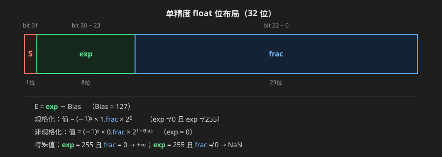
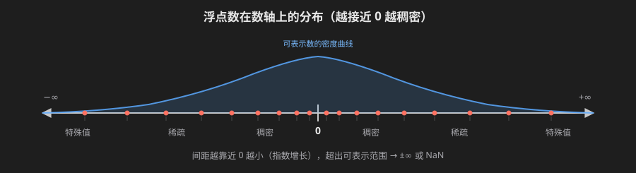
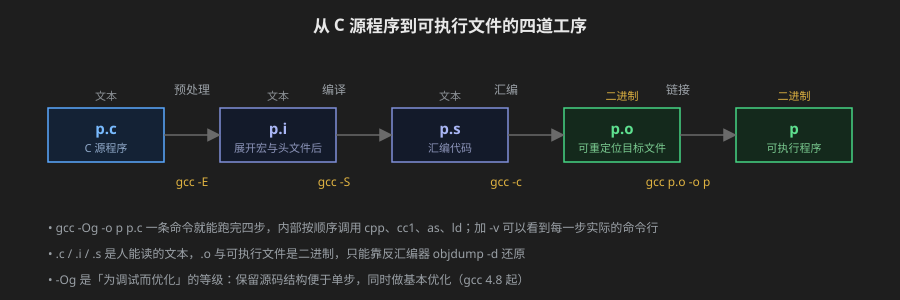
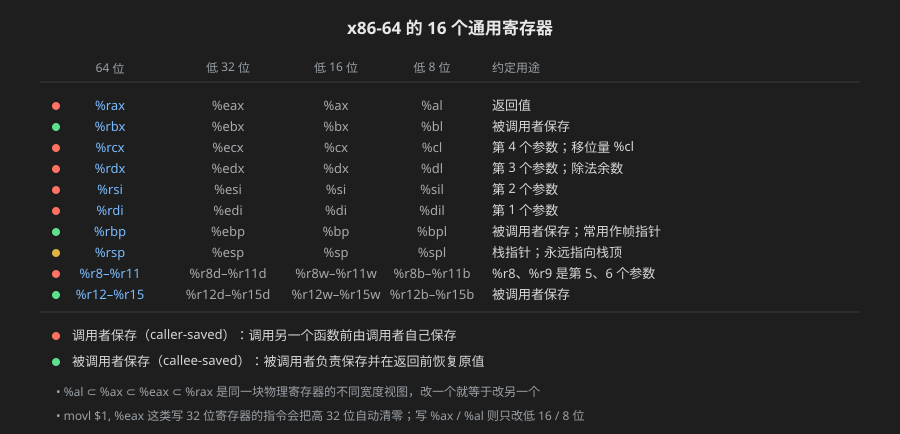
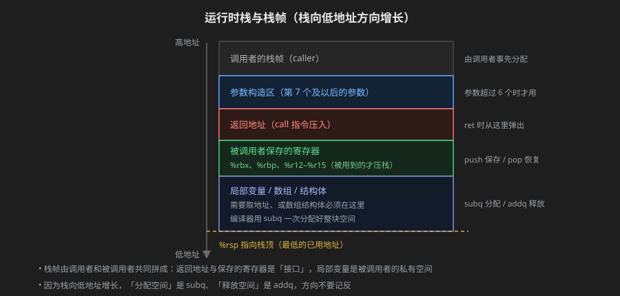
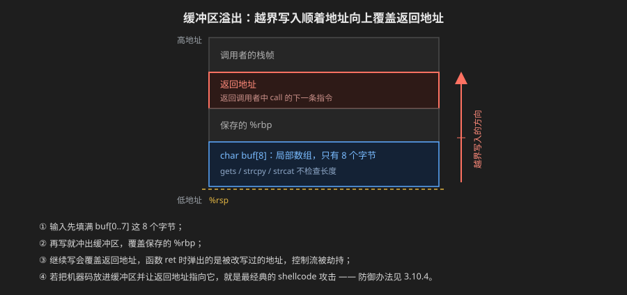

# 深入理解计算机系统

## Part.1 程序结构和执行

### 信息的表示和处理

#### 2.1 信息存储

+ 现代计算机使用**字节(byte)[^1] **寻址系统，字节是最小的可寻址内存单位
+ 机器将内存视为一个非常大的字节数组,称为**虚拟地址(virtual address)**
+ 程序对象（数据、指令）以**字节序列**存储在内存中，机器通过虚拟地址访问这些对象
+ 内存中的每一个字节都由一个唯一的数字来标识,称为这个字节的**地址**
+ 所以可能的地址集合称为虚拟地址空间[^2]

[^1]: 一个字节为八个二进制位(bit),每一个二进制位可以写入0/1,故一个字节可以表示$2^{8}$个数
[^2]: 字长为w的机器,可以访问$2^{w}$个字节
##### 2.1.1 十六进制表示法[^3]

[^3]: 为什么用十六进制：每4个二进制位对应1个十六进制位，可读性强，转换方便。

+ 一个字节 = 8位 = 2个十六进制位
+ 十六进制数字：0~9 与 A~F（代表 10~15），编程中常用 0x 或 0X 前缀，如 0xAF = 175
+ 十六进制与二进制转换：**逐组映射**，每1个十六进制位 ↔ 4个二进制位
  + 0x5A2B → 0101 1010 0010 1011
  + 0x8000 → 1000 0000 0000 0000
+ 十六进制与十进制转换
  + 十进制→十六进制：不断除以16，取余数，余数从低位往高位排列
  + 十六进制→十进制：Σ 各位*$16^k$，如 0x11 = 1×16 + 1 = 17
  
##### 2.1.2 字数据大小

+ **字长(word size)**：指针/地址的字节数[^4]，决定虚拟地址空间大小 = $2^w$ 字节
+ 32位程序：最大 4GB 空间；64位程序：最大 16EB（实际只使用低48位，约256TB）
+ 同一个程序编译为32位/64位时，有些类型大小会变化，**long 和指针最典型**
+ C语言基本数据类型大小（64位 x86-64 典型值，可用 sizeof 确认）

[^4]: 字长为64的机器 一个指针/地址占用64位(8个字节) 即16个十六进制字符

| C类型         | 位数 | C类型          |         位数         |
| :------------ | :--: | :------------- | :------------------: |
| char          |  8   | long           | 64（32位系统上为32） |
| short         |  16  | long long      |          64          |
| int           |  32  | 指针 char\* 等 |          64          |
| unsigned int  |  32  | float          |          32          |
| unsigned long |  64  | double         |          64          |

+ 编程注意：跨平台代码不要假定 int 与 long 同宽，用 sizeof 或固定宽度类型 stdint.h 的 int32_t、int64_t
+ 有符号的 char 在不同机器上可能默认为有符号或无符号，C标准未规定，由实现决定

##### 2.1.3 寻址与字节顺序

+ 多字节对象在内存中按**字节地址连续存放**，但字节排列顺序有两种约定
  + **小端法(little endian)**：最低有效字节放在最低地址位置（x86、大多数PC）
  + **大端法(big endian)**：最高有效字节放在最低地址位置（早期PowerPC、网络字节序）
+ 以 int 值 0x01234567 为例：

```markdown
地址： 0x100 0x101 0x102 0x103
大端法： 01    23    45    67
小端法： 67    45    23    01
```

+ 大小端何时会出问题？
  1. 网络传输：网络协议（如TCP/IP头）规定用**大端**，发送/接收端可能需要字节反转（htons/ntohl）
  2. 反汇编代码、查看内存dump：阅读机器级代码时需要知道字节序
  3. 类型的强制转换：按字节访问多字节对象时结果依赖字节序
+ 用代码确认机器的大小端（C语言）

```c
#include <stdio.h>
typedef unsigned char *byte_pointer;

void show_bytes(byte_pointer start, size_t len) {
    for (size_t i = 0; i < len; i++)
        printf(" %.2x", start[i]);
    printf("\n");
}

int main(void) {
    int x = 0x01234567;
    show_bytes((byte_pointer)&x, sizeof(int));
    // 小端机器输出： 67 45 23 01
    // 大端机器输出： 01 23 45 67
    return 0;
}
```

##### 2.1.4 表示字符串

+ 字符串由字符码的字节序列表示，常见采用 ASCII 编码
+ 例如字符串 "12345"（C语言）在内存中的字节为 `31 32 33 34 35 00`（最后是终止符 '\0' 即 0x00）
+ 字符串逐字节存储，与**大小端无关**，因此跨平台安全；多字节字符（中文GBK/UTF-8）取决于具体编码规范

##### 2.1.5 表示代码

+ 指令也以字节序列表示，**但不是普通数据**：同一段C代码编译出的机器码在不同指令集架构（x86-64/ARM/MIPS）上完全不同
+ 机器码不是"标准化的"，不能直接把 x86 的二进制搬到 ARM 上运行
+ 反汇编（如 objdump -d）可把字节序列翻译回汇编，供人阅读

##### 2.1.6 布尔代数

+ 二进制与逻辑值：bit=1 表示"真"，0 表示"假"
+ 基本布尔运算：非(~)、与(&)、或(|)、异或(^)[^5]

[^5]: 异或 x^y 在且仅在不相等时为1，即"比特位不同"。异或很有用的性质：x^0=x，x^x=0，x^y^y=x（可用于不用临时变量的交换或简单加密）

```markdown
A B | ~A | A&B | A|B | A^B
0 0 | 1 | 0 | 0 | 0
0 1 | 1 | 0 | 1 | 1
1 0 | 0 | 0 | 1 | 1
1 1 | 0 | 1 | 1 | 0
```

+ 常用定律（与集合论一一对应）
  + 交换律 / 结合律 / 分配律：A&(B|C) = (A&B)|(A&C)，A|(B&C) = (A|B)&(A|C)
  + **德摩根律**：~(A|B) = ~A & ~B；~(A&B) = ~A | ~B
  + 补集：A & ~A = 0，A | ~A = 1（满位）

##### 2.1.7 C语言中的位级、逻辑与移位运算

+ **位级运算**：~ & | ^ 操作对象是整数，对**每一位**独立计算

```c
int x = 0x0F, y = 0x30;
x & y        // 0x00  按位与
x | y        // 0x3F  按位或
x ^ y        // 0x3F  按位异或
~x           // 0xFFFFFFF0 （对32位int）
// 常用技巧：取低8位 x & 0xFF；只翻转某一位 x ^ (1<<k)
```

+ 注意位级运算与比较运算的**优先级坑**：与(&)优先级低于 \==，所以 `x & 0xFF == 0` 会被解析为 `x & (0xFF==0)`，务必加括号
+ **逻辑运算**：! && || 返回值只能是 0 或 1
  + 与位级运算的区别：对整体真值判断，而非逐位；有**短路**求值（左侧已能决定结果则不计算右侧）

```c
int x = 0, y = 5;
x && (y = 10);   // x为假，短路：右侧不求值，y 仍是 5
!x               // 1
!!x              // 0  用两个!!可把任意非零值规范化为 0/1
```

+ **移位运算**：左移 `<<`，右移 `>>`
  + x86上对有符号数右移是**算数右移**（补符号位）；对无符号数是**逻辑右移**（补0）
  + 左移丢弃最高位、低位补0：x << 2 等价于 x×4（无溢出时）
  + 算数右移等价于除以2的幂（向下取整，见2.3.5）
  + **移位量 >= 字长是未定义行为**；移位量为负同样未定义。如 `int x = 1; x << 32` 结果不可
+ 无符号编码是**双射**：w位位向量 ↔ {0, 1, …, 2<sup>w</sup>-1} 一一对应，不浪费任何位模式

#### 2.2 整数表示

> 给位模式定"解释规则"是本章的核心：同一组位 0101，按无符号读是 5，按补码读也是 5；而 1101 分别读作 13 与 -3。要先知道类型有多大、能装多少（2.2.1），再学两种编码规则（2.2.2、2.2.3）。

##### 2.2.1 整型数据类型

+ C 标准**不规定整数类型的精确大小**，只保证一个最小范围，实际大小由机器与编译器共同决定，跨平台代码不要假定宽度（可用 sizeof 现场确认）
+ 常见实现下的典型大小（单位：字节），注意区分 **32 位机器与 64 位机器**

| C 类型         | 32 位机器 | 64 位机器 | 说明                 |
| :------------- | :-------: | :-------: | :------------------- |
| char           |     1     |     1     | 恒定 1 字节          |
| short          |     2     |     2     | 至少 16 位           |
| int            |     4     |     4     | 32 位 int 是事实标准 |
| long           |     4     |     8     | **宽度随机器变化**   |
| long long      |     8     |     8     | C99 起，至少 64 位   |
| 指针 char\* 等 |     4     |     8     | 与字长一致           |
| float          |     4     |     4     | 浮点，见 2.4         |
| double         |     8     |     8     | 浮点，见 2.4         |

+ 观察：从 32 位到 64 位，**只有 long 和指针变宽**，int 始终 4 字节。业界用"数据模型"描述这套约定：
  + **ILP32**：int、long、指针都是 32 位 —— 32 位平台（x86、ARM32）
  + **LP64**：long 与指针为 64 位，int 仍 32 位 —— 主流 64 位 Unix/Linux/macOS（x86-64、AArch64）
  + **LLP64**：long long 与指针为 64 位，**long 保持 32 位** —— 64 位 Windows（MSVC）
  + 实例：`sizeof(long)` 在 Linux(x86-64) 上是 8，在 Windows(x64) 上却是 4，别想当然认为 long 就是 64 位
+ C 标准保证的最小范围（任何实现都至少能表示，实际通常更大）

| 有符号类型 | 保证的最小范围                       | 无符号类型         | 保证的最小范围       |
| :--------- | :----------------------------------- | :----------------- | :------------------- |
| char       | -127 ~ 127                           | unsigned char      | 0 ~ 255              |
| short      | -32767 ~ 32767                       | unsigned short     | 0 ~ 65535            |
| int        | -32767 ~ 32767                       | unsigned           | 0 ~ 65535            |
| long       | -2147483647 ~ 2147483647             | unsigned long      | 0 ~ 4294967295       |
| long long  | -2<sup>63</sup>+1 ~ 2<sup>63</sup>-1 | unsigned long long | 0 ~ 2<sup>64</sup>-1 |

（注意：标准下限比现实小得多，例如 int 只"保证"16 位以上——只是现实中 int 都是 32 位。）

+ 常见实现下的**实际取值范围**（补码，区分 32/64 位，仅 long 不同）：

| 有符号类型           | 范围                               | 无符号类型                             | 范围                                       |
| :------------------- | :--------------------------------- | :------------------------------------- | :----------------------------------------- |
| char                 | -128 ~ 127                         | unsigned char                          | 0 ~ 255                                    |
| short                | -32768 ~ 32767                     | unsigned short                         | 0 ~ 65535                                  |
| int                  | -2147483648 ~ 2147483647           | unsigned int                           | 0 ~ 4294967295                             |
| long(32位)           | -2147483648 ~ 2147483647           | unsigned long(32位)                    | 0 ~ 4294967295                             |
| long(64位)/long long | -2<sup>63</sup> ~ 2<sup>63</sup>-1 | unsigned long(64位)/unsigned long long | 0 ~ 2<sup>64</sup>-1 ≈ 1.8×10<sup>19</sup> |

+ 实际范围不必死记：limits.h 已定义 INT_MAX、INT_MIN、UINT_MAX、LONG_MAX 等宏，代码里直接引用即可
+ 可移植代码优先用 stdint.h 的**定宽类型**：int8_t / int16_t / int32_t / int64_t（及 uint 前缀的无符号版），宽度固定、不随机器变化
+ 另一个易忽略点：**char 的符号性由实现决定**，C 标准没有规定 char 默认带不带符号（x86 上多为 signed）；需要明确时写 signed char / unsigned char
+ sizeof 返回 size_t（无符号），打印用 %zu：

```c
printf("int   = %zu 字节\n", sizeof(int));    // 32/64 位都是 4
printf("long  = %zu 字节\n", sizeof(long));   // 32位:4；LP64:8；Windows64:4
printf("char* = %zu 字节\n", sizeof(char*));  // 32位:4，64位:8
```

+ 与 2.1.2 的衔接：那里列过 64 位典型值表，此处补全 32/64 对照与标准保证；类型宽度定了之后，2.2.2/2.2.3 再研究位模式如何映射成数值

##### 2.2.2 无符号数的编码

+ **定义(B2U, Binary → Unsigned)**：把 w 位位向量 x = [x<sub>w-1</sub>, …, x<sub>1</sub>, x<sub>0</sub>] 解释成二进制数——从**最低位 x<sub>0</sub>**（最右，权重 2<sup>0</sup>）到**最高位 x<sub>w-1</sub>**（最左，权重 2<sup>w-1</sup>），各位乘以其权重再求和
  + B2U<sub>w</sub>(x) = Σ x<sub>i</sub> · 2<sup>i</sup> （i = 0 ~ w-1）
  + 例（w=4）：B2U<sub>4</sub>([1011]) = 1×2<sup>3</sup> + 0×2<sup>2</sup> + 1×2<sup>1</sup> + 1×2<sup>0</sup> = 8 + 0 + 2 + 1 = 11

```markdown
w=4 时的部分映射（数字下标即各位权重）
位模式 计算 无符号值
0000 0+0+0+0 0
0101 0×8 + 1×4 + 0×2 + 1×1 5
1011 1×8 + 0×4 + 1×2 + 1×1 11
1111 8 + 4 + 2 + 1 15
```

+ **表示范围**
  + 最小值 UMin<sub>w</sub> = 0：全 0 位模式 [00…0]
  + 最大值 UMax<sub>w</sub> = 2<sup>w</sup> - 1：全 1 位模式 [11…1]

| 宽度 w | C 类型示例                    | 范围                                       |
| :----: | :---------------------------- | :----------------------------------------- |
|   8    | unsigned char                 | 0 ~ 255                                    |
|   16   | unsigned short                | 0 ~ 65535                                  |
|   32   | unsigned int                  | 0 ~ 4294967295                             |
|   64   | unsigned long long / uint64_t | 0 ~ 2<sup>64</sup>-1 ≈ 1.8×10<sup>19</sup> |

+ 无符号数**没有负数**：每一位的权重都是正的，连最高位的权重 2<sup>w-1</sup> 也是正的，不存在"符号位"
+ **双射性质**：2<sup>w</sup> 种位模式与 [0, 2<sup>w</sup>-1] 内 2<sup>w</sup> 个整数一一对应——每种位模式唯一确定一个值，每个值也唯一对应一种位模式，不重不漏
+ 语义定位：无符号适合表示本身不为负的"量"，如地址、长度、个数，C 中的 size_t 就是无符号的
+ 预告两个坑（详见后文）：① 无符号数永远非负，递减到 0 之后会回卷成 UMax（见 2.3.1）；② 与有符号数混用时会被隐式转换，-1 也会变成巨大的正数（见 2.2.5）

##### 2.2.3 补码编码 B2T

+ 有符号数在几乎所有机器上都用**补码**表示，最高位的权重是**负的**
+ 为什么用补码？在补码下**加法和减法共用一套加法器**：x - y = x + (~y + 1)，硬件简单；原码、反码则正负数的加法规则不同
+ w=4 时补码的数环：

```markdown
0101 = 5 1000 = -8
0111 = 7 1111 = -1
0000 = 0 1111 + 1 → 0000 （溢出回卷）
```

+ 验证方法：任意 w 位"按位取反再加一"就是取负
+ 补码特性：**TMin 的非还是 TMin 本身**（1000...0 取反加1还是 1000...0）；-0 与 0 相同，没有浪费

##### 2.2.4 有符号与无符号的转换

+ 位级层面**不发生任何变化**，变的只是解释方式，转换是纯数学映射
+ T2U<sub>w</sub>(x)：若 x < 0，则 T2U<sub>w</sub>(x) = x + 2<sup>w</sup>，否则不变
  + 例：-1 → 0xFFFFFFFF（32位）
+ U2T<sub>w</sub>(u)：若 u >= 2<sup>w-1</sup>，则 U2T<sub>w</sub>(u) = u - 2<sup>w</sup>，否则不变
  + 例：0x80000000（无符号读为 2147483648）→ -2147483648
+ 数学本质：两者是**模 2<sup>w</sup> 的同余关系**，只是取值区间的裁剪不同

```markdown
位模式 0b1100 (w=4)：无符号 = 12，有符号 = -4（= 12 - 16）
```

##### 2.2.5 C语言中的有符号数与无符号数[^6]

[^6]: C标准规定：当运算符两侧一个有符号一个无符号且宽度相同时，**有符号数被隐式转为无符号**（除非有符号类型范围能包含所有无符号值）。这是无数bug的源头。

+ 隐式转换的坑：**-1 < 0U 为假**！因为 -1 先转成 0xFFFFFFFF = 4294967295，再与 0U 比较
+ 经典bug：for 循环用无符号数递减到负数时，条件永远成立

```c
unsigned i;
for (i = n; i > 0; i--);   // 正确写法：i==0 时退出
// 反例：i >= 0 永远为真 → 死循环或越界
```

+ 再如 strlen 返回 size_t（无符号）：`strlen(a) - strlen(b) > 0` 在 a 短于 b 时依然为"真"（变成巨大的无符号数）
+ 经验：比较运算里**不要混用有符号与无符号**；printf 用 %d/%u 与类型不匹配也会读错值

##### 2.2.6 扩展数字的位表示

+ 扩展（短类型→长类型）有两种，位模式不变只是高位补齐
  + **零扩展**：高位补0，用于无符号 short→int
  + **符号扩展**：高位补原最高位的符号位，用于有符号 short→int
+ 关键理解：符号扩展不会改变数值大小（补充的高位权重恰好与原符号位等值）

```c
short sx = -12345;        // 位模式 0xCFC7
unsigned short usx = sx;  // 0xCFC7 （65533，无符号解释）
int x = sx;               // 0xFFFFCFC7 （符号扩展到32位，仍是 -12345）
unsigned uy = usx;        // 0x0000CFC7 （零扩展）
```

##### 2.2.7 截断数字

+ 长类型→短类型：只保留低 k 位，即**取模 2<sup>k</sup>**
  + 例：unsigned 0xFFFFFFFF (4294967295) 截断为 unsigned short → 0xFFFF = 65535 = 4294967295 mod 65536
+ 无符号截断 = 模 2<sup>k</sup> 运算；有符号截断 = 先模 2<sup>k</sup> 得到无符号值，再按有符号解释（可能变负数）

#### 2.3 整数运算

> 这一节是"溢出"的来源。C语言整数运算按 w 位计算，**超过 w 位的结果直接被丢弃（回卷 wrap-around）**，不报错、不抛异常。

##### 2.3.1 无符号加法

+ 常规加法 s = x + y，溢出时取 s mod 2<sup>w</sup>（最高位进位丢弃）
+ **溢出检测**：无符号加法溢出当且仅当 s < x（等价于 s < y），因为溢出意味着结果回卷变小

```c
unsigned x = 0xFFFFFFFF, y = 1;
unsigned s = x + y;   // 0x00000000，溢出；检测：s < x → 溢出
```

##### 2.3.2 补码加法

+ 补码加法是把 x+y 按**模 2<sup>w</sup>** 计算后再解释为有符号数，会出现两种溢出
  + **正溢出（上溢）**：两个正数之和超过 TMax，结果变负
  + **负溢出（下溢）**：两个负数之和小于 TMin，结果变正
+ 检测规则
  + 正溢出：x > 0，y > 0，但 s < 0
  + 负溢出：x < 0，y < 0，但 s >= 0

```c
int x = 0x7FFFFFFF, y = 1;
int s = x + y;        // 0x80000000 = -2147483648（正溢出，和变成负数）
```

```markdown
补码数环(w=4)： 7+1 → 1000 = -8（正溢出，跨过顶端到负区）
-8 + -1 → 0111 = 7（负溢出）
```

##### 2.3.3 补码的非（取反）

+ 求 -y（w位）：**按位取反再加1**，-y = ~y + 1
+ 特例：TMin 的非是它自身（它没有正数对应）
+ 应用：减法 x - y 硬件上统一用加法实现：x + (~y + 1)

##### 2.3.4 乘法

+ w位乘法：把 x·y 的完整乘积**截断到低 w 位**（模 2<sup>w</sup>），高位丢弃
+ 无符号乘法：x·y mod 2<sup>w</sup>
+ 补码乘法：完整乘积截断后按有符号解释
+ **重要结论：无符号乘法与补码乘法的 w 位结果（位模式）完全相同**——模 2<sup>w</sup> 同余的必然结果
+ 溢出例子：200×300×400×500

```c
int x = 200 * 300 * 400 * 500;        // 真实值120亿 > 21亿，截断后 = -884901888
unsigned u = 200u * 300u * 400u * 500u; // 3410065408 = 120亿 mod 2^32
```

##### 2.3.5 乘以常数与除以2的幂

+ **乘以 2 的幂**：x << k 等价于 x × 2<sup>k</sup>（无溢出时）；编译器会把 x\*2<sup>k</sup> 优化为移位
+ **乘以任意常数**：拆成移位+"加减"组合，如 x × 14 = (x<<4) - (x<<2)，x × 15 = (x<<4) - x

```c
// 编译器实际就是这么优化的（第3章机器级表示会看到）
x * 14;   // 等价于 (x << 4) - (x << 2)
x * 7;    // 等价于 (x << 3) - x
```

+ **除以 2 的幂**：无符号数 x >> k（逻辑右移）即 x/2<sup>k</sup>，向下取整
+ 对有符号数，直接算数右移得到的是 **floor（向负无穷舍入）**，而 C 的 / 是**向零舍入**，负数时不一致：-7/2 = -3（向零），-7>>1 = -4（floor）
+ **加偏置修复**：要让移位除法等于"向零舍入"，先加偏置 bias = 2<sup>k</sup> - 1 再右移
+ 即 `(x + (1<<k) - 1) >> k`（x >= 0 时偏置不影响结果，同样成立）

```c
int x = -7, k = 2;
int a = x >> k;                 // -7>>2 = -2（floor，不匹配 C 的 -7/4=-1）
int b = (x + (1<<k) - 1) >> k;  // (-7+3)>>2 = (-4)>>2 = -1 = -7/4 ✓
```

+ 提示：编译器处理 x/8 时，对负数会生成"加偏置再算数右移"的指令序列（第3章可见）

#### 2.4 浮点数

> 浮点数只能表示实数的近似子集：靠近0的数最稠密，越远越稀疏。浮点运算是有限精度、**可能舍入**的，IEEE 754 是标准格式。

##### 2.4.1 二进制小数

+ 二进制小数逢二进一，小数点右边第 k 位的权重是 1/2<sup>k</sup>

```markdown
二进制小数： 101.101₂ = 4 + 1 + 1/2 + 1/8 = 5.625
0.1011₂ = 1/2 + 0/4 + 1/8 + 1/16 = 0.6875
```

+ 注意：很多十进制小数（如 0.1）在二进制下是**无限循环小数**，永远无法精确表示 → 浮点误差的根源
+ 类比：浮点数就是二进制科学计数法（十进制 1.234×10<sup>2</sup> ↔ 二进制 1.xxx×2<sup>E</sup>）

##### 2.4.2 IEEE浮点表示

+ 一个浮点数用 **V = (−1)<sup>s</sup> × M × 2<sup>E</sup>** 表示
  + s：符号位(sign)
  + M：尾数(significand)，范围 [1,2) 或 [0,1)
  + E：阶码(exponent)
+ 两种格式

| 格式          | 总位数 | 符号s | 阶码exp | 尾数frac | Bias |
| :------------ | :----: | :---: | :-----: | :------: | :--: |
| 单精度 float  |   32   |   1   |    8    |    23    | 127  |
| 双精度 double |   64   |   1   |   11    |    52    | 1023 |



+ 三种编码情形（以单精度为例）
  + **规格化的值(normalized)**：exp 不全0也不全1（1~254）。尾数隐含最高位1，即 M = 1.frac
    + E = exp - 127
    + 例：1.0 → exp = 127（0111 1111），frac 全0
  + **非规格化的值(denormalized)**：exp 全0。此时 M = 0.frac，E = 1 - Bias（固定），用于表示**0 和极其接近 0 的数**（渐进下溢，保证数轴上相邻浮点数间距连续）
  + **特殊值**：exp 全1
    + frac 全0 → ±∞（如 1.0/0.0）
    + frac 非0 → NaN（Not a Number，如 0.0/0.0、sqrt(-1)）



##### 2.4.3 浮点数字示例

+ 例：12.375 的 float 编码
  + 12.375 = 1100.011<sub>2</sub> = 1.100011 × 2<sup>3</sup>
  + exp = 3 + 127 = 130 = 10000010
  + frac = 100011 后补0至23位 → 10001100000000000000000
  + 编码：0 10000010 10001100000000000000000
+ 关键数值（单精度）
  + 最小正规格化数：2<sup>-126</sup> ≈ 1.2e-38
  + 最大正规格化数：(2 - 2<sup>-23</sup>) × 2<sup>127</sup> ≈ 3.4e38
  + 最小正非规格化数：2<sup>-149</sup> ≈ 1.4e-45
  + 机器精度 epsilon：2<sup>-23</sup> ≈ 1.19e-7（float），2<sup>-52</sup> ≈ 2.2e-16（double）

##### 2.4.4 舍入

+ 运算结果无法精确表示时必须舍入，IEEE 定义四种模式
  + **向偶数舍入（round-to-even，默认）**：舍入到最近的值，恰好在正中间时舍入到最低位为偶数（偶数的）那个
    + 十进制例：1.5→2，2.5→2，3.5→4；二进制例：1.011 舍入到小数点后2位 → 1.10（因为 1.011 恰在 1.01 与 1.10 中间，取偶数尾0）
  + 向零舍入、向下舍入、向上舍入：一般只在计算定积分上下界等场景手动指定
+ 为什么默认向偶数：避免统计误差单方向累积（如 1.5+2.5 各舍入到2，不偏不倚）

##### 2.4.5 浮点运算

+ 浮点加/乘的结果先精确计算再舍入到最近可表示值，**可能损失精度**
+ 浮点运算**不满足结合律和分配律**：

```c
// 1e20 很大，3.14 在舍入时被"吞掉"
(3.14 + 1e20) - 1e20   // → 0.0
3.14 + (1e20 - 1e20)   // → 3.14

// 结果随顺序变化，是很多数值算法误差的来源
```

+ 浮点数的交换律成立（加法、乘法都交换），只是结合律、分配律不成立
+ 浮点比较要小心：直接比较相等（==）在计算结果有舍入时容易失败，常用差值容差判断

```c
float a = 0.1f, b = 0.2f;
// a + b == 0.3f 通常为假！应改用 fabs(a + b - 0.3f) < 1e-6
```

##### 2.4.6 C语言中的浮点数

+ C 提供 float（单精度）、double（双精度）、long double（扩展精度，实现相关）
+ int/float/double 之间转换规则
  + int → float：可能**舍入损失精度**（float尾数只有24位有效，>2<sup>24</sup>的int可能不准）
  + int → double：精确（double 53位尾数 ≥ 32位int）
  + float → double：精确（变宽）
  + double → float：可能**溢出为 ±∞** 或损失精度
  + float/double → int：向零截断，且**溢出行为未定义**（超出int范围的结果不可预知）

```c
int i = 16777217;      // 2^24 + 1
float f = i;           // f = 16777216.0（损失1，float无法表示 2^24+1）
double d = i;          // d = 16777217.0（精确）
int j = (int)3.9e10;   // 未定义行为，不要这样写
```

+ 何时用 float：嵌入式/GPU等对内存和速度敏感的场景；科学计算默认 double

### 程序的机器级表示

#### 3.2 程序编码

> 从 C 源程序到可执行文件要过四道工序：预处理、编译、汇编、链接

+ 一条命令走完全流程

```shell
gcc -Og -o p p.c
```

+ `-o p` 指定输出的可执行文件名，缺省时叫 a.out
+ `-Og` 是**为调试而优化**的等级（gcc 4.8 起）：保留源码结构、便于单步，同时做基本优化，生成的代码比 -O0 更接近真实程序，又不像 -O2 那样把结构改得面目全非
+ 四个阶段也可以拆开单独执行

```shell
gcc -E p.c -o p.i #预处理,插入所有用#include指定的文件,并扩展所有宏
gcc -S p.i -o p.s #编译,将预处理后的代码转化为汇编代码
gcc -c p.s -o p.o #汇编,汇编器将汇编代码转化为二进制目标代码文件
gcc p.o -o p      #链接,链接器将目标代码文件与实现库函数的代码合并成可执行文件
```



##### 3.2.1 机器级代码

+ 计算机系统用**两种抽象**屏蔽细节
  + **指令集架构（ISA）**：定义机器级程序的格式与行为——指令格式、寄存器、状态，所有程序都按 ISA 的规定执行
  + **虚拟地址**：机器级程序把内存看成一个巨大的字节数组，这个数组就是虚拟地址空间
+ 汇编程序员可见的处理器状态只有几样
  + **程序计数器（PC，x86-64 里是 %rip）**：指向下一条要执行的指令
  + **整数寄存器文件**：16 个 64 位寄存器，存地址或整数（见 3.4）
  + **条件码寄存器**：保存最近一次算术/逻辑运算的状态，用于控制流（见 3.6）
  + **一组向量寄存器**：存放一个或多个整数或浮点数据（见 3.11）
+ 机器指令只做几类事：算地址与做算术、在内存和寄存器之间搬数据、控制转移、过程的调用与返回
+ 从 C 到机器级，类型和变量名vanished
  + **类型信息**：机器级只认"几个字节"，char/int/long 都是 1/2/4/8 字节的整数，甚至不区分指针和整数
  + **变量名**：只剩地址与偏移
+ 程序内存里放的也不只是代码：可执行机器码、操作系统需要的运行信息、运行时栈、用户分配的内存块

##### 3.2.2 代码示例

+ 用一个最小例子走完整过程

```c
long mult2(long, long);

void multstore(long x, long y, long *dest) {
    long t = mult2(x, y);
    *dest = t;
}
```

+ `gcc -Og -S mstore.c` 生成汇编文件 mstore.s，只摘出关键部分

```asm
multstore:
    pushq   %rbx
    movq    %rdx, %rbx
    call    mult2
    movq    %rax, (%rbx)
    popq    %rbx
    ret
```

+ 逐行读：%rdx 是第三个参数 dest，先存进 %rbx（%rdx 会被 call 覆盖，见 3.7.5）；x、y 留在 %rdi、%rsi 里直接传给 mult2；返回值在 %rax，写回 dest
+ `gcc -Og -c mstore.c` 生成**目标文件** mstore.o——这已经是二进制，用编辑器打开只会看到乱码
+ 要看清楚里面是什么，用反汇编器

```shell
objdump -d mstore.o
```

```asm
0000000000000000 <multstore>:
   0:   53                      push   %rbx
   1:   48 89 d3                mov    %rdx,%rbx
   4:   e8 00 00 00 00          callq  9 <multstore+0x9>
   9:   48 89 03                mov    %rax,(%rbx)
   c:   5b                      pop    %rbx
   d:   c3                      retq
```

+ 左边是字节的十六进制编码，中间是反汇编出的指令；一条指令占 1~15 字节，所以地址不是连续的
+ `callq 9 <multstore+0x9>` 的目标指向**下一条指令**，因为这个地址要等链接时才确定，objdump 先把占位符显示出来
+ 换成 -O1 / -O2 编译，这段代码会面目全非（可能被内联、寄存器被重用），所以看汇编必须固定优化等级

##### 3.2.3 关于格式的注解

+ 汇编文件里除了指令还有大量**汇编器指令**（assembler directive，以 `.` 开头，本身不产生机器码）

| 汇编器指令           | 含义                                         |
| :------------------- | :------------------------------------------- |
| `.text`              | 以下内容放入代码段                           |
| `.data`              | 以下内容放入已初始化数据段                   |
| `.globl multstore`   | 声明 multstore 为全局符号，其他文件可见      |
| `.string "..."`      | 放入一个以 `\0` 结尾的字符串                 |
| `.align 8`           | 后续数据按 8 字节对齐（配合 3.9.3 的对齐规则）|
| `.type`、`.size`     | 符号的类型与大小，供链接器和调试器使用       |

+ `#` 开头的是注释；gcc 生成的 .s 里还有很多 `.cfi_*` 伪指令用于异常处理与调试信息，加 `-fno-asynchronous-unwind-tables` 可以去掉，读起来清爽很多
+ **AT&T 与 Intel 两种语法**要能互相翻译

| 特征       | AT&T（gcc / objdump 默认） | Intel                |
| :--------- | :------------------------- | :------------------- |
| 操作数顺序 | 源在前，目的在后           | 目的在前，源在后     |
| 寄存器前缀 | `%rax`                     | `rax`                |
| 立即数前缀 | `$0x10`                    | `0x10` / `10h`       |
| 大小后缀   | `movl`、`movq`             | 由操作数长度体现     |
| 内存引用   | `8(%rax,%rdx,4)`           | `[rax+rdx*4+8]`      |
| 间接跳转   | `jmp *%rax`                | `jmp rax`            |

+ 切换方式：`objdump -d -M intel` 输出 Intel 语法；gcc 加 `-masm=intel` 让生成的 .s 用 Intel 语法
+ 本书一律使用 AT&T 语法，网上查资料时常见 Intel 语法，别把操作数顺序读反

#### 3.3 数据格式

> 机器指令里没有"类型"，只有宽度。C 的类型信息编译后就消失了，汇编改用后缀标出操作数占几个字节。

+ x86-64 用后缀标明操作数大小[^7]

| 后缀 | 名称               | 字节 | 位数 | 典型 C 类型       | 指令例子    |
| :--: | :----------------- | :--: | :--: | :---------------- | :---------- |
|  b   | 字节 byte          |  1   |  8   | char              | movb、addb  |
|  w   | 字 word            |  2   |  16  | short             | movw、addw  |
|  l   | 双字 double word   |  4   |  32  | int、unsigned     | movl、addl  |
|  q   | 四字 quad word     |  8   |  64  | long、指针        | movq、addq  |

+ 注意 x86 的"字"是 16 位（8086 的历史包袱），**不是机器字长**，64 位机器上照样用 w 表示 2 字节
+ 后缀跟的是**操作数大小**，跟 C 类型没有必然联系：`movl $1, %eax` 里的 l 只是说"按 32 位处理目的寄存器"
+ 浮点另有一套后缀，靠指令族区分

| 后缀 | 含义           | 字节 | 指令例子         |
| :--: | :------------- | :--: | :--------------- |
|  s   | 单精度 single  |  4   | movss、addss     |
|  l   | 双精度 double  |  8   | movsd、addsd     |

+ 同一个字母 l 在整数指令里是 4 字节、在浮点指令里是 8 字节，看到 l 先确认这是整数指令还是浮点指令
+ 对照 2.2.1 的类型宽度表：C 的 char/short/int/long 到机器级就对应 b/w/l/q 四种宽度

[^7]: AT&T 语法的操作数顺序是"源在前、目的在后"（`mov 源, 目的`），Intel 语法相反。本书与 gcc 默认输出都是 AT&T。

#### 3.4 访问信息

> 一个 x86-64 的 CPU 有 16 个 64 位通用寄存器，用来存整数和指针。要在机器级读写数据，先要搞清楚"数据存在哪"与"怎么指代它"。

+ 16 个通用寄存器：%rax、%rbx、%rcx、%rdx、%rsi、%rdi、%rbp、%rsp、%r8~%r15
+ 每个寄存器都能按 64/32/16/8 位访问，靠不同前缀区分：%rax → %eax → %ax → %al；%r8 → %r8d → %r8w → %r8b
+ 用途约定（ABI 约定而非硬件强制）



+ 两条容易踩的规则
  + 写 32 位寄存器会**把高 32 位清零**：执行 `movl $1, %eax` 后 %rax 整个是 1，而不是保留旧的高位
  + 写 16/8 位寄存器**只改低位**，高位保持原样

##### 3.4.1 操作数指示符

+ 指令的操作数有三种基本形式

| 类型   | 形式 | 操作数的值 | 例子   |
| :----- | :--- | :--------- | :----- |
| 立即数 | $Imm | Imm 本身   | $0x1F  |
| 寄存器 | R    | R 的内容   | %rax   |
| 存储器 | Mem  | M[Mem]     | (%rax) |

+ 存储器的通用寻址形式：`Imm(rb, ri, s)` = Imm + R[rb] + R[ri] × s，其中 s ∈ {1, 2, 4, 8}
  + rb 基址寄存器、ri 变址寄存器、s 比例因子、Imm 偏移量，四部分都可省略
  + 比例因子只能是 1/2/4/8，且**变址寄存器不能用 %rsp**

| 写法                | 有效地址             | 典型用途                |
| :------------------ | :------------------- | :---------------------- |
| `(%rax)`            | R[%rax]              | 解引用指针              |
| `8(%rax)`           | R[%rax] + 8          | 取结构体字段 / 数组元素 |
| `(%rax,%rdx)`       | R[%rax] + R[%rdx]    | 两个数相加当地址        |
| `(%rax,%rdx,4)`     | R[%rax] + R[%rdx]×4  | 访问 int 数组 a[i]      |
| `0x10(,%rdx,8)`     | 0x10 + R[%rdx]×8     | 没有基址的数组访问      |

+ 记住规律：圆括号里算的是地址，整串 `Imm(rb, ri, s)` 的值本身就是一个地址；**要不要真的去访问这个地址，取决于指令**（leaq 就只算不访，见 3.5.1）

##### 3.4.2 数据传送指令

+ mov 类指令把源操作数复制到目的操作数：`mov 源, 目的`

| 指令                          | 效果              | 说明                                    |
| :---------------------------- | :---------------- | :-------------------------------------- |
| movb / movw / movl / movq     | D ← S             | 按 1/2/4/8 字节传送                     |
| movabsq $Imm, R               | R ← 64 位立即数   | 只有它能装下完整的 64 位立即数          |
| movz 系列（movzbw、movzbl、movzwl、movzbq、movzwq） | D ← 零扩展(S) | 高位补 0                          |
| movs 系列（movsbw、movsbl、movswl、movsbq、movswq、movslq） | D ← 符号扩展(S) | 高位补符号位      |
| cltq                          | %rax ← 符号扩展(%eax) | 等价于 movslq %eax, %rax           |

+ 两条硬性限制
  + 源和目的**不能同时是存储器**，内存到内存必须拆成两条（先读进寄存器）
  + 立即数只能作源，不能作目的
+ 关于扩展指令的两个细节
  + 没有 `movzlq`：把 32 位零扩展到 64 位直接用 `movl` 就行——写 32 位寄存器本来就清零高 32 位
  + 扩展指令的两个操作数宽度必须不同且目的更宽，且目的必须是寄存器：`movzbl %al, %edx` ✓，`movzbl %al, %dl` ✗

##### 3.4.3 数据传送示例

```c
long exchange(long *xp, long y) {
    long x = *xp;   /* 读指针指向的值 */
    *xp = y;        /* 写回同一个地址 */
    return x;
}
```

```asm
exchange:
    movq    (%rdi), %rax    # x = *xp（%rdi 存 xp，%rax 存返回值）
    movq    %rsi, (%rdi)    # *xp = y（%rsi 存 y）
    ret
```

+ 两条指令就够了：**参数在寄存器里（%rdi 指针、%rsi 值），返回值放 %rax**
+ `(%rdi)` 说明"指针就是地址"：解引用 = 把地址塞进寻址模式
+ `*xp` 在等号左边还是右边，只影响这条 mov 的方向

##### 3.4.4 压入和弹出栈数据

+ 栈（stack）是按"后进先出"使用的一块内存，**向低地址方向增长**，%rsp 保存栈顶元素的地址
+ pushq 与 popq 各等价于两条指令

```asm
pushq %rax                  popq %rax
  subq $8, %rsp               movq (%rsp), %rax
  movq %rax, (%rsp)           addq $8, %rsp
```

+ 即：%rsp 减 8 表示"分配"，加 8 表示"回收"
+ 出栈并没有擦掉数据：popq 只把 %rsp 上移，原处的字节还在，下次 push 才会覆盖
+ 常见陷阱：push/pop 会改 %rsp，若同一段代码还在用 (%rsp) 相对寻址局部变量，顺序算错就会读错数据

#### 3.5 算术和逻辑操作

> 这一节把整数运算落到指令上。贯穿全章的规律是：**操作数的宽度决定结果是否回卷**——第 2 章讲的补码回卷，就是这里 l/q 后缀造成的。

+ 常用整数指令总表（AT&T 语法，源在前）

| 类别         | 指令                     | 效果        | 说明                       |
| :----------- | :----------------------- | :---------- | :------------------------- |
| 加载有效地址 | leaq S, D                | D ← &S      | 只算地址、不访存           |
| 一元         | incq、decq、negq、notq   | D±1、−D、~D | 只有一个操作数             |
| 二元         | addq、subq、imulq、andq、orq、xorq | D ← D op S | 第二个操作数既是源又是目的 |
| 移位         | salq/shlq、sarq、shrq    | 左移、算术右移、逻辑右移 | 移位量是立即数或 %cl |

+ `subq S, D` 是 **D ← D − S**，写在前面的永远是源，别按 Intel 的习惯读
+ 二元指令的第一操作数可以是立即数、寄存器或存储器；第二操作数（目的）可以是寄存器或存储器，但不能是立即数

##### 3.5.1 加载有效地址

+ `leaq S, D`：把 S 的**地址**算出来放进 D，不读内存
+ 它的地址计算器支持 基址 + 变址×比例 + 偏移，所以编译器把它当"三操作数加法器"用

```c
long scale(long x, long y, long z) {
    return x + 4 * y + 12 * z;
}
```

```asm
scale:
    leaq    (%rdi,%rsi,4), %rax    # rax = x + 4y
    leaq    (%rdx,%rdx,2), %rdx    # rdx = z + 2z = 3z
    leaq    (%rax,%rdx,4), %rax    # rax = (x+4y) + 3z*4 = x + 4y + 12z
    ret
```

+ 对照：用乘法要两次 imulq 加两次 addq，leaq 版本只要三条，延迟也更短
+ 读数技巧：`leaq 7(%rdx,%rdx,4), %rax` 就是 `rax = 5*x + 7`

##### 3.5.2 一元和二元操作

+ 一元指令只有一个操作数，它同时是源和目的：`incq (%rdi)` 是"把内存里的数加 1"
+ 二元指令的第二个操作数既是源又是目的，所以 `addq %rax, %rbx` 读作 `rbx += rax`

```asm
addq    %rcx, %rdx      # rdx += rcx
subq    $8, %rsp        # rsp -= 8
imulq   %rbx, %rax      # rax *= rbx（只保留低 64 位）
negq    %rdi            # rdi = -rdi
```

+ 注意 `subq $8, %rsp` 与 `subq %rax, %rsp` 都合法：立即数也能作第一操作数

##### 3.5.3 移位操作

+ 移位量可以是立即数，或**只能**用 %cl 指定

```asm
salq    $4, %rax        # rax <<= 4，等价于乘 16
shlq    $4, %rax        # 与 salq 完全相同
sarq    %cl, %rdx       # 算术右移，高位补符号位
shrq    %cl, %rdx       # 逻辑右移，高位补 0
```

+ sal 与 shl 是同一个操作的两个名字；右移分两种，**sar 补符号位（有符号用）、shr 补 0（无符号用）**，编译器按类型选
+ x86 会丢弃移位量的高位（64 位操作数取低 6 位，32 位取低 5 位），所以 C 里写 `x << 32` 实际变成 `x << 0`，属于未定义行为（呼应 2.1.7）

##### 3.5.4 讨论

+ 编译器特别爱用 leaq 做小常数乘法：x×3 是 `leaq (%rdi,%rdi,2), %rax`，x×5 是 `leaq (%rdi,%rdi,4), %rax`，x×9 是 `leaq (%rdi,%rdi,8), %rax`
+ 除以 2 的幂仍然只能靠 sar/shr，有符号数的偏置修正与 2.3.5 完全一致
+ 一个直观的检查方法：看到汇编里出现连续的 leaq，先怀疑它是在做乘法或复合的地址计算，而不是真的在取地址

##### 3.5.5 特殊的算术操作

+ 两个 64 位数相乘得到 128 位结果时，需要一对寄存器 RDX:RAX

| 指令     | 效果                                | 说明                     |
| :------- | :---------------------------------- | :----------------------- |
| imulq S  | RDX:RAX ← S × RAX（有符号 128 位）  | 单操作数形态             |
| mulq S   | RDX:RAX ← S × RAX（无符号 128 位）  | 单操作数形态             |
| cqto     | RDX:RAX ← 符号扩展(RAX)             | 为 idivq 准备 128 位被除数 |
| idivq S  | RAX ← 商，RDX ← 余数（有符号）      | 除以 0 或商溢出会触发异常 |
| divq S   | RAX ← 商，RDX ← 余数（无符号）      | 同上                     |

+ idivq 之前必须先用 `cqto` 把 RAX 符号扩展到 RDX:RAX，否则 RDX 里的垃圾会让商错得离谱
+ idivq 本身是**向零截断**，与 C 的 `/` 一致；而移位是向下取整，两者在负数上不同——这正是 2.3.5 里"除 2 的幂要加偏置"的根因

#### 3.6 控制

> 机器码里没有 if、while，只有"测试条件码 + 跳转"。这一节把 C 的三种控制结构（条件、循环、switch）逐一翻译成跳转。

##### 3.6.1 条件码

+ CPU 维护一组 1 位的条件码，记录最近一次算术/逻辑运算的结果特征

| 标志 | 名称     | 置位条件                                         |
| :--: | :------- | :----------------------------------------------- |
|  CF  | 进位标志 | 无符号运算最高位产生了进位（可看作无符号溢出）   |
|  ZF  | 零标志   | 最近一次运算的结果为 0                           |
|  SF  | 符号标志 | 最近一次运算的结果为负数                         |
|  OF  | 溢出标志 | 补码运算发生了正溢出或负溢出                     |

+ 两个"不老实"的指令
  + **leaq 不修改条件码**（它只算地址）
  + **inc / dec 不修改 CF**（只改 ZF/SF/OF），判断"加 1 是否进位"不能用 inc
+ 想专门测试而不改数据，用比较/测试指令

| 指令           | 计算      | 用途                                 |
| :------------- | :-------- | :----------------------------------- |
| cmpq S1, S2    | S2 − S1   | 据差值设条件码，两个操作数都不改     |
| testq S1, S2   | S1 & S2   | 判断某位是否为 0、或整个值是否为 0   |

+ `cmpq %rsi, %rdi` 算的是 rdi − rsi，所以随后的 `setl` 含义是"rdi < rsi"——**比较方向与书写顺序相反**，这是读反汇编最常见的错源

##### 3.6.2 访问条件码

+ 条件码不能直接读，要用 set 指令把它变成一个字节的 0/1[^8]
+ 各种"条件"与条件码组合的对应关系（set/j 通用）

| 条件               | 条件码组合        | 后缀 |
| :----------------- | :---------------- | :--- |
| 相等 / 零          | ZF                | e / z |
| 不相等 / 非零      | ~ZF               | ne / nz |
| 负数 / 非负        | SF / ~SF          | s / ns |
| 大于（有符号）     | ~(SF ^ OF) & ~ZF  | g    |
| 大于等于（有符号） | ~(SF ^ OF)        | ge   |
| 小于（有符号）     | SF ^ OF           | l    |
| 小于等于（有符号） | (SF ^ OF) \| ZF   | le   |
| 大于（无符号）     | ~CF & ~ZF         | a    |
| 大于等于（无符号） | ~CF               | ae   |
| 小于（无符号）     | CF                | b    |
| 小于等于（无符号） | CF \| ZF          | be   |

+ 语义记法：**有符号比较看 SF ^ OF**（符号位与溢出位异或），**无符号比较看 CF**
+ set 指令的目的只能是 8 位寄存器（%al、%r8b …），想要 32/64 位结果还得再扩一次

```c
int comp(long a, long b) { return a < b; }
```

```asm
comp:
    cmpq    %rsi, %rdi      # 计算 a - b
    setl    %al             # al = (a < b) ? 1 : 0
    movzbl  %al, %eax       # 零扩展到 32 位（顺带清掉高 32 位）
    ret
```

[^8]: set 只是"按条件码把一个字节置 0 或 1"，它本身不产生条件码，所以前面必须有一条 cmp/test 先把条件码设好。

##### 3.6.3 跳转指令

+ jmp 无条件跳转，分直接（`jmp .L1`）与间接（`jmp *%rax`、`jmp *(%rax)`）
+ 条件跳转与 set 用同一套条件码组合，只是后缀换成 j

| 指令              | 条件     | 说明          |
| :---------------- | :------- | :------------ |
| je / jz、jne / jnz | ZF、~ZF | 相等 / 不等   |
| js、jns           | SF、~SF  | 负 / 非负     |
| jg、jge、jl、jle  | 见上表   | 有符号比较    |
| ja、jae、jb、jbe  | 见上表   | 无符号比较    |

+ jg 与 ja 的差别只在"有符号/无符号"，两条指令长得几乎一样，读代码时先确认操作数的类型

##### 3.6.4 跳转指令的编码

+ 直接跳转编码的是**相对偏移**（目标地址 − 下一条指令地址），而不是绝对地址
  + 好处：代码可以整体搬移（重定位）而不失效，指令也短（常用 1 字节偏移）
+ 偏移是补码，所以既能往前跳也能往后跳

```asm
4005d0:  eb 03     jmp    4005d5    # 03 = 下一条(4005d2) + 3
4005d2:  7c e5     jl     4005b9    # e5 = -27，4005d4 - 27 = 4005b9
```

+ 反汇编器（objdump）显示的已经是算好的绝对地址，人不用自己加
+ 间接跳转（`jmp *%rax`）编码的是寄存器/内存里的绝对地址，这是 switch 跳转表与函数指针调用的基础

##### 3.6.5 用条件控制实现条件分支

+ C 的 if-else 最直接的翻译：先算条件码，再按条件跳到 then 或 else 标签

```c
long absdiff(long x, long y) {
    long result;
    if (x < y) result = y - x;
    else       result = x - y;
    return result;
}
```

```asm
absdiff:
    cmpq    %rsi, %rdi      # x - y
    jge     .L2             # 若 x >= y，走 else
    movq    %rsi, %rax
    subq    %rdi, %rax      # then: y - x
    ret
.L2:
    movq    %rdi, %rax
    subq    %rsi, %rax      # else: x - y
    ret
```

+ 这就是 C 里 `goto` 的直译；反过来，任何用 goto 写的控制流都能这样翻
+ 代价：分支预测失败时流水线要清空（十几到几十个周期），所以编译器会尽量不用跳转——见下一节

##### 3.6.6 用条件传送实现条件分支

+ cmov 系列指令：先算出两个分支的结果，再按条件码**选一个写回**，全程不改变控制流

| 指令              | 含义          | 指令              | 含义           |
| :---------------- | :------------ | :---------------- | :------------- |
| cmove / cmovne    | 相等 / 不等   | cmovg / cmovge    | 有符号 > / ≥   |
| cmovs / cmovns    | 负 / 非负     | cmovl / cmovle    | 有符号 < / ≤   |
| cmova / cmovae    | 无符号 > / ≥  | cmovb / cmovbe    | 无符号 < / ≤   |

+ 同样的 absdiff 可以写成无分支版本

```asm
absdiff:
    movq    %rdi, %rax
    subq    %rsi, %rax      # rax = x - y
    movq    %rsi, %rdx
    subq    %rdi, %rdx      # rdx = y - x
    cmpq    %rsi, %rdi      # x - y
    cmovl   %rdx, %rax      # 若 x < y 则取 rdx
    ret
```

+ 好处：没有跳转就没有预测失败，现代 CPU 上通常更快；坏处：两条路径都要算
+ **不是所有 if 都能这样优化**：若某条分支可能产生副作用或异常，就不能无条件地先算

```c
long cread(long *p) { return (p ? *p : 0); }   /* 不能换成 cmov：p 为 NULL 时先解引用会崩 */
```

+ 编译器只在"两边都便宜且都安全"时才用 cmov，这是汇编结构与源码结构对不上的主要原因之一

##### 3.6.7 循环

+ C 的循环到汇编只有一种骨架：**条件跳回**；区别在于第一次怎么进入循环
+ do-while 先执行一次再测条件；while / for 通常编译成"guarded-do"（先测一次，再进 do-while 骨壳）

```c
long fact_for(long n) {
    long result = 1;
    for (long i = 2; i <= n; i++)
        result *= i;
    return result;
}
```

```asm
fact_for:
    movl    $1, %eax        # result = 1
    movl    $2, %edx        # i = 2
    jmp     .L8             # 跳到条件测试（guarded-do）
.L9:
    imulq   %rdx, %rax      # result *= i
    addq    $1, %rdx        # i++
.L8:
    cmpq    %rdi, %rdx      # i - n
    jle     .L9             # i <= n 则继续
    rep; ret
```

+ `jmp` 跳到中间的写法称为 jump to middle，它让"条件不成立时一次都不执行"自然成立
+ 循环不变量提升（把循环里不变的表达式搬到循环外）是最常见的优化之一，所以源码里的循环体在汇编里可能"变短"了

##### 3.6.8 switch 语句

+ switch 用**跳转表（jump table）**实现：一个数组，第 i 项是 case i 对应代码块的地址
+ 前提是 case 值比较密集（跨度不大），否则表太大；稀疏时编译器退回一串 if-else 比较

```c
switch (x) {
case 0:  return 0;
case 1:  return 1;
case 2:  return 2;
case 3:  return 3;
case 4:  return 4;
default: return -1;
}
```

```asm
    cmpq    $4, %rdi        # 越界检查
    ja      .L8             # 无符号比较：x > 4 或 x < 0 都走 default
    jmp     *.L4(,%rdi,8)   # 间接跳转：取表中第 x 项地址
```

+ `ja` 在这里同时挡住负数和越界，是常用技巧：**无符号比较把"负数"归到"很大"里**
+ `jmp *.L4(,%rdi,8)` 里的 8 是指针宽度，说明表项是 8 字节地址
+ 跳转表放在 .rodata 段，各 case 的地址在链接后固定
+ 时间复杂度 O(1) 且与 case 个数无关，这是 switch 相对 if-else 链的核心优势

#### 3.7 过程

> 过程（函数、方法）需要三个机制：传递控制（call/ret）、传递数据（参数、返回值）、分配和释放内存（栈帧）。x86-64 用寄存器传参、用栈保存状态。

##### 3.7.1 运行时栈

+ 栈帧（stack frame）：一次函数调用占用的那一段栈
+ 从高地址往低看，一个典型栈帧包含[^9]



+ 返回地址由 call 自动压栈，其余部分由被调用者用 subq 分配
+ 关键认识：**栈帧边界不是固定的**，编译器可以省掉帧指针 %rbp，直接用 %rsp 相对寻址（-fomit-frame-pointer 是 -O1 及以上的默认行为）

[^9]: 严格说参数构造区属于调用者的栈帧，只是被调用者从中读取参数；画在交界处是因为它服务于被调用者。

##### 3.7.2 控制转移

+ call 做两件事：**把返回地址压栈，然后跳到目标**
+ ret 做一件事：**从栈顶弹出返回地址，跳过去**
+ 目标可以是直接地址（`call .L1`）或间接地址（`call *%rax`，函数指针）

```asm
call    .L1                # 直接调用
call    *%rax              # 间接调用，目标地址在寄存器里
call    *(%rdi)            # 间接调用，目标地址在内存里
```

+ 等价写法：`call .L1` ≡ `pushq $下一条指令地址` + `jmp .L1`
+ `ret` 概念上等价于 `popq %rip`（%rip 不能直接 pop，由硬件实现）

##### 3.7.3 数据传送

+ 参数按顺序放进 6 个寄存器，多出来的走栈；返回值放 %rax

| 序号     | 1    | 2    | 3    | 4    | 5    | 6    | 7 及以上 |
| :------- | :--- | :--- | :--- | :--- | :--- | :--- | :------- |
| 寄存器   | %rdi | %rsi | %rdx | %rcx | %r8  | %r9  | 栈       |

+ 注意第 3 个是 %rdx、第 4 个才是 %rcx——**顺序是 rdi, rsi, rdx, rcx, r8, r9**，不要按字母序记
+ 返回值统一放 %rax（浮点例外，放 %xmm0，见 3.11）

```c
void proc(long a1, long *a1p, int a2, int *a2p, short a3, short *a3p, char a4, char *a4p) {
    *a1p += a1;
    *a2p += a2;
    *a3p += a3;
    *a4p += a4;
}
```

```asm
proc:
    movq    16(%rsp), %rax  # a4p 是第 8 个参数 → 在栈上
    addq    %rdi, (%rsi)    # *a1p += a1
    addl    %edx, (%rcx)    # *a2p += a2
    addw    %r8w, (%r9)     # *a3p += a3
    movl    8(%rsp), %edx   # a4 是第 7 个参数 → 在栈上
    addb    %dl, (%rax)     # *a4p += a4
    ret
```

+ 观察：前 6 个参数在寄存器里，第 7、8 个在栈上（8(%rsp)、16(%rsp)，因为 (%rsp) 是返回地址）
+ 参数类型比寄存器窄时只用低位：int 用 %edx、short 用 %r8w、char 用 %dl

##### 3.7.4 栈上的局部存储

+ 什么时候必须把局部变量放栈上
  1. 寄存器不够用
  2. 需要对变量取地址（&x），寄存器没有地址
  3. 局部变量是数组或结构体
  4. 变量要跨函数调用保持，且不想占用被调用者保存寄存器
+ 分配与释放各一条指令完成，边界一次算好

```c
long call_proc(void) {
    long  x1 = 1;
    int   x2 = 2;
    short x3 = 3;
    char  x4 = 4;
    proc(x1, &x1, x2, &x2, x3, &x3, x4, &x4);
    return (x1 + x2) * (x3 - x4);
}
```

```asm
call_proc:
    subq    $32, %rsp       # 一次分配 32 字节
    movq    $1, 16(%rsp)    # x1
    movl    $2, 24(%rsp)    # x2
    movw    $3, 28(%rsp)    # x3
    movb    $4, 30(%rsp)    # x4
    ...                     # 传参并 call proc
    addq    $32, %rsp       # 一次释放
    ret
```

+ 注意偏移都是正数：**局部变量在 %rsp 之上（更高地址）**，因为 %rsp 指向栈顶（最低的已用地址）

##### 3.7.5 寄存器中的局部存储空间

+ 寄存器分两类，这是 ABI 里最容易出错的一组约定

| 类别         | 寄存器                                    | 谁负责保存                   |
| :----------- | :---------------------------------------- | :--------------------------- |
| 调用者保存   | %rax、%rdi、%rsi、%rdx、%rcx、%r8–%r11    | 调用者在 call 前自己保存     |
| 被调用者保存 | %rbx、%rbp、%r12–%r15                     | 被调用者用到就先 push、返回前 pop |

+ 通俗记法：**调用者保存 = 借了要还，被调用者保存 = 用完要还原**
+ 编译器通常把要跨调用保持的变量放进 %rbx 或 %r12–%r15，函数开头压栈、结尾弹栈

```asm
foo:
    pushq   %rbx            # 保存被调用者保存寄存器
    movq    %rdi, %rbx      # 把跨调用要用的值搬进去
    call    bar
    movq    %rbx, %rax      # 调用回来还能用
    popq    %rbx            # 恢复原值
    ret
```

##### 3.7.6 递归过程

+ 递归不需要特殊指令：每次 call 自动分配一个新栈帧，ret 时自动回收，**栈本身就是递归的实现机制**
+ 关键是"每次调用有独立的局部状态"：寄存器会被覆盖，所以递归函数必须把状态放栈上（或被调用者保存寄存器里）

```c
long rfact(long n) {
    long result;
    if (n <= 1) result = 1;
    else        result = n * rfact(n - 1);
    return result;
}
```

```asm
rfact:
    pushq   %rbx            # 保存 n（要跨 call 使用）
    movq    %rdi, %rbx
    movl    $1, %eax        # result 默认 1
    testq   %rdi, %rdi
    jle     .L35            # n <= 0 直接返回 1
    leaq    -1(%rdi), %rdi  # 参数 n-1
    call    rfact
    imulq   %rbx, %rax      # result = n * rfact(n-1)
.L35:
    popq    %rbx
    ret
```

+ 为什么要 push %rbx：%rdi 会被递归调用改掉，%rbx 是被调用者保存的，递归返回后还能拿到原来的 n
+ 递归太深会栈溢出（栈大小通常 8MB）；尾递归可被编译器改写成循环（-O2 常见），但没有标准保证

#### 3.8 数组分配和访问

> C 的数组是"一块连续内存 + 首地址"，机器级只有地址计算，没有边界检查。

##### 3.8.1 基本原则

+ 声明 `T A[N]`：在内存里连续分配 N × sizeof(T) 字节，A 的值就是首元素地址
+ 访问 A[i] 就是访问地址 A + i × sizeof(T)，下标本质上是一次**带比例因子的寻址**

```asm
# int A[5]，首地址在 %rdx，i 在 %rcx
movl    (%rdx,%rcx,4), %eax     # eax = A[i]，4 = sizeof(int)
```

+ 比例因子只能是 1/2/4/8，正好覆盖 char/short/int/long 与指针——**这就是 x86 寻址模式专门为数组设计的原因**
+ 数组名不是指针变量：`sizeof(A)` 是整个数组大小，`&A` 与 `A` 的数值相同但类型不同

##### 3.8.2 指针运算

+ 指针算术自动按所指类型缩放：`p + i` 的实际字节偏移是 i × sizeof(*p)
+ 三种等价写法：`A[i]` ≡ `*(A + i)` ≡ `*(i + A)`（所以 `i[A]` 也合法，只是没人这么写）
+ 指针相减得到的是**元素个数**而非字节数，编译器会自动除以 sizeof

```c
int *p = A;
int  x = *(p + 2);        // 等价于 A[2]
long d = &A[5] - &A[2];   // 3，不是 12
```

+ 指针运算只在同一个数组内有定义，跨数组相减是未定义行为

##### 3.8.3 嵌套的数组

+ C 的多维数组是**行优先（row-major）**：`int A[5][3]` 等价于 5 个"含 3 个 int 的数组"依次排列
+ `A[i][j]` 的地址 = A + (i × 3 + j) × 4，编译器用两次 leaq 完成

```asm
# A 在 %rdi，i 在 %rsi，j 在 %rdx
leaq    (%rsi,%rsi,2), %rax     # rax = 3i
leaq    (%rdi,%rax,4), %rax     # rax = A + 12i（第 i 行首地址）
movl    (%rax,%rdx,4), %eax     # eax = A[i][j]
```

+ 由此推出两条实用结论
  + `A[i]` 的类型是"含 3 个 int 的一维数组"，在表达式里退化成指向首元素的 int*
  + 行优先意味着按行遍历（内层循环走 j）才缓存友好，按列遍历会不断跳跃

##### 3.8.4 变长数组

+ C99 允许 `int A[n]`，n 在运行时才确定（变长数组 VLA）
+ 编译器不能用固定的 leaq 常数算地址，改成运行时的 imulq / 移位

```asm
# long A[n]，n 在 %rdi
movq    %rdi, %rax
salq    $3, %rax            # n * 8
subq    %rax, %rsp          # 在栈上分配
```

+ VLA 的代价：地址计算变成真正的乘法指令，且栈帧大小不再在编译期固定（见 3.10.5）
+ `long A[n][m]` 的地址计算需要 n × m 的乘法，比固定大小的数组慢不少

#### 3.9 异质的数据结构

> struct 和 union 把不同类型拼在一起，对齐规则决定它们实际占多少空间——也是 sizeof 题的重灾区。

##### 3.9.1 结构

+ struct 把各字段按声明顺序放进一块连续内存，字段偏移量在编译期就确定
+ 访问字段 = 基址 + 常数偏移，一条指令完成

```c
struct rec { int a[4]; int i; struct rec *next; };
```

| 字段     | 偏移 | 大小 |
| :------- | :--: | :--: |
| a[0..3]  |  0   | 16   |
| i        | 16   |  4   |
| next     | 24   |  8   |

+ 偏移 20~23 是对齐填充（见 3.9.3），所以结构体总大小是 32 而不是 28
+ 结构体整体作参数传递时是**按值复制**；作返回值时若太大，调用者会传一个隐藏参数（存放结果的地址），被调用者往那块内存里写
+ `p->i` 与 `(*p).i` 等价，汇编里都是"取 p 的值（地址）+ 偏移 16"

##### 3.9.2 联合

+ union 的所有字段共享同一块内存，总大小 = 最大字段大小（再按对齐取整）
+ 两种典型用途
  + **节省空间**：几个字段互斥（同一时刻只有一个有效），如符号表的"字符串/整数"二选一
  + **类型双关**：把同一组字节按另一种类型解释，如查看 float 的位模式
+ union 的坑是**字节序**：用 union 把 int 当 char 数组读，结果依赖大小端（呼应 2.1.3）

```c
union U { char c; int i; double d; };   // sizeof = 8，不是 13
```

+ 现代 C 更推荐用 memcpy 做类型转换：union 双关在严格别名规则下属于实现定义行为

##### 3.9.3 数据对齐

+ x86-64 的约定：**任何 K 字节的基本对象，其地址必须是 K 的倍数**（K = 1、2、4、8）
+ 动机：对齐后一次内存访问就能取到数据；不对齐时 CPU 可能要拆成两次访问（某些架构直接报错）
+ 编译器在字段之间插入**填充（padding）**，并保证结构体总大小是最大对齐数的整数倍

```c
struct S1 { char c; int i; char d; };
struct S2 { int i; char c; char d; };
```

| 结构 | 布局                                    | sizeof |
| :--- | :-------------------------------------- | :----: |
| S1   | c@0，填充 1~3，i@4~7，d@8，填充 9~11    |   12   |
| S2   | i@0~3，c@4，d@5，填充 6~7               |   8    |

+ 同样的字段换个顺序，大小差了 50%——**把大字段放在前面**能减小结构体
+ 两个实用结论
  + `sizeof(struct)` ≥ 字段大小之和，永远不能假设两者相等
  + 结构体数组的元素之间也可能有填充，这与"数组元素连续"不矛盾（填充算在元素内部）
+ 对齐可以被强制改变：`#pragma pack(1)` 或 `__attribute__((packed))` 取消填充，但可能让访问变慢甚至出错（取成员地址时），只在协议报文这类必须紧凑的场景用

#### 3.10 在机器级程序中将控制与数据结合起来

> 这一节把前面所有东西拼起来：指针的本质、调试工具，以及 C 最著名的安全漏洞来源。

##### 3.10.1 理解指针

+ 指针的六条规则（把 C 的抽象落到机器上）
  1. 每个指针都有类型，类型决定解引用时读几个字节、按什么解释
  2. 指针的值是一个地址，指针变量本身也占内存（8 字节）
  3. `&x` 取地址（leaq），`*p` 解引用（mov）
  4. 数组与指针紧密相关：数组名在表达式里退化为首元素地址
  5. 指针可以强制转换，本质是"换一种类型解释同一串字节"，不改变位模式
  6. 函数指针的值是代码段的地址，可以间接调用

```asm
leaq    8(%rdi), %rax   # 相当于 &p[1] 或 p + 1
movq    (%rax), %rbx    # 相当于 p[1]
call    *%rax           # 通过函数指针调用
```

+ 强转的危险不在转换本身，而在于**转换后按错误的宽度/对齐/类型去访问**

##### 3.10.2 应用：使用 GDB 调试器

+ 看汇编和单步执行是理解机器级行为最直接的办法

| 命令                          | 作用                                     |
| :---------------------------- | :--------------------------------------- |
| `disas` / `disas 函数名`      | 反汇编当前函数                           |
| `break *0x4005d0`             | 在指定地址下断点                         |
| `stepi` / `si`                | 单步一条机器指令（会进入 call）          |
| `nexti` / `ni`                | 单步一条机器指令（不进入 call）          |
| `info registers`              | 查看所有寄存器                           |
| `print $rax` / `p $rax`       | 查看某个寄存器                           |
| `x/8gx 0x7fffffffe000`        | 以 8 个 8 字节十六进制查看内存           |
| `x/10i $pc`                   | 从当前指令往后看 10 条                   |

+ `x/` 的格式串 = 数量 + 格式（x 十六进制、d 十进制、s 字符串、i 指令）+ 单位（b/w/g）
+ 调试机器码时最常用 `x/10i $pc`，比反汇编整个函数更聚焦

##### 3.10.3 内存越界引用和缓冲区溢出

+ C 对数组引用**不做任何边界检查**，越界写就是直接写相邻内存
+ 一批标准库函数天生不安全：gets、strcpy、strcat、sprintf 都不检查目标缓冲区大小

```c
void echo(void) {
    char buf[8];           /* 只有 8 字节 */
    gets(buf);             /* 读多少写多少，完全不检查 */
    puts(buf);
}
```



+ 攻击链条：超长输入 → 覆盖保存的 %rbp → 覆盖返回地址 → 函数 ret 时跳到攻击者指定的地址
+ 两种后果
  + 程序崩溃，最简单的拒绝服务
  + 若攻击者把机器码放进缓冲区并让返回地址指向缓冲区开头，就获得任意代码执行（shellcode）
+ 这类漏洞的本质是**把用户输入当代码/地址处理**，与现代的 SQL 注入、格式化字符串漏洞同源

##### 3.10.4 对抗缓冲区溢出攻击

+ 系统层面有三道防线，现代 Linux 默认全开

| 机制               | 做法                                                     | 攻击者的困难                                     |
| :----------------- | :------------------------------------------------------- | :----------------------------------------------- |
| 栈随机化（ASLR）   | 每次运行栈的起始地址随机                                 | 猜不到缓冲区地址，难以让返回地址指向注入代码     |
| 栈破坏检测（栈保护）| 在返回地址前放一个随机"金丝雀"值，返回前检查             | 覆盖返回地址时会顺手破坏金丝雀，程序立即终止     |
| 不可执行栈（NX 位）| 页表标记栈/堆所在页不可执行                              | 注入的机器码一执行就触发段错误                   |

+ 栈保护的实际布局：金丝雀从 %fs:0x28 读入，返回前再比一次，不一致就调用 __stack_chk_fail

```asm
    movq    %fs:40, %rax        # 读金丝雀
    movq    %rax, 8(%rsp)       # 放在返回地址之前
    ...
    movq    8(%rsp), %rax
    xorq    %fs:40, %rax        # 比较
    jne     __stack_chk_fail
```

+ NX 之下攻击者转向 ROP：不注入新代码，而是拼接程序里已有的指令片段
+ 编程层面的根本办法：**不用 gets、strcpy 这类不检查长度的函数**，改用 fgets、strncpy/snprintf 或带长度参数的接口

##### 3.10.5 支持变长栈帧

+ 大多数函数的栈帧大小编译期已知，%rsp 直接加减常数即可
+ 但 `alloca` 或 VLA 让栈帧大小运行时才定，此时编译器恢复用 **%rbp 作帧指针**，好让局部变量的偏移保持常数

```asm
vframe:
    pushq   %rbp            # 保存旧帧指针
    movq    %rsp, %rbp      # 建立新帧指针
    subq    %rdi, %rsp      # 按参数动态分配
    ...
    movq    %rbp, %rsp      # leave 的前半：恢复 %rsp
    popq    %rbp            # leave 的后半：恢复 %rbp
    ret
```

+ `leave` 一条指令就等价于 `movq %rbp, %rsp` + `popq %rbp`，是函数返回前的标准收尾
+ 有帧指针时局部变量写作 `-8(%rbp)` 这种常数偏移；没有帧指针时只能用 `8(%rsp)` 这种随分配变化的偏移
+ 代价：%rbp 被占用，少一个可用寄存器——这是 -fomit-frame-pointer 成为默认优化的原因

#### 3.11 浮点代码

> 从 SSE2 起，x86-64 的浮点运算走 XMM 寄存器，不再用 8087 的栈式寄存器。规则和整数部分几乎平行，只是寄存器名与指令名全新。

+ 16 个 128 位的 XMM 寄存器（%xmm0 ~ %xmm15），只用于浮点；AVX 起扩展到 256 位的 YMM

##### 3.11.1 浮点传送和转换操作

+ 传送指令按精度分 s（单精度）与 d（双精度）

| 指令                    | 效果                          | 说明                          |
| :---------------------- | :---------------------------- | :---------------------------- |
| movss / movsd           | 内存 ↔ XMM，或 XMM ↔ XMM      | 传送 4 / 8 字节               |
| movaps / movapd         | XMM ↔ XMM 或对齐内存          | 寄存器之间传送用这个          |
| cvtsi2ss / cvtsi2sd     | 整数 → 单/双精度              | 源是通用寄存器                |
| cvttss2si / cvttsd2si   | 单/双精度 → 整数              | 多一个 t：truncate，向零截断  |
| cvtss2sd / cvtsd2ss     | 单 ↔ 双精度                   | 变宽 / 变窄                   |

+ 关键区分：**整数 → 浮点，目的在 XMM；浮点 → 整数，目的在通用寄存器**
+ 不带 t 的 cvtsd2si 按当前舍入模式（默认向零），带 t 的一定截断

```c
double d = (double) i;    /* cvtsi2sd   %eax, %xmm0  */
int    i = (int) d;       /* cvttsd2si  %xmm0, %eax  */
```

+ 越界转换的行为：浮点值超出 int 范围时 cvttsd2si 返回 0x80000000（"整数不定值"），C 里属于未定义行为（呼应 2.4.6）

##### 3.11.2 过程中的浮点代码

+ 浮点参数用 %xmm0 ~ %xmm7 传，返回值放 %xmm0；整型参数与浮点参数**各自独立编号**
+ 所有 XMM 寄存器都是**调用者保存**：没有"被调用者保存"的浮点寄存器，要跨调用保持就得自己压栈

```c
double f(double a, double b, double x) {   /* a=%xmm0, b=%xmm1, x=%xmm2 */
    return a * x + b;
}
```

```asm
f:
    mulsd   %xmm2, %xmm0    # xmm0 = a * x
    addsd   %xmm1, %xmm0    # xmm0 += b
    ret
```

+ 混合参数示例：`void g(int i, double d, long l)` → i 在 %rdi、d 在 %xmm0、l 在 %rsi（整型寄存器单独计数）

##### 3.11.3 浮点运算操作

+ 基本运算都是一条指令，第二个操作数既是源又是目的（与整数一致）

| 指令（单/双）                    | 效果                  |
| :------------------------------- | :-------------------- |
| addss / addsd                    | D ← D + S             |
| subss / subsd                    | D ← D − S             |
| mulss / mulsd                    | D ← D × S             |
| divss / divsd                    | D ← D ÷ S             |
| maxss / maxsd、minss / minsd     | D ← max/min(D, S)     |
| sqrtss / sqrtsd                  | D ← √S（单操作数）    |

+ 每个指令都有 v 前缀的 AVX 三操作数版本（`vaddsd S1, S2, D`），可以避免"先复制目的操作数"的多余 mov
+ 浮点比较用 ucomiss / ucomisd，设置的是 ZF、PF、CF 而不是那套整数条件码，判断时要配对使用 `jb` / `ja` 等
+ 浮点没有移位：`x / 2.0` 依然是 divsd，编译器不会把它变成右移

##### 3.11.4 定义和使用浮点常数

+ 浮点指令**没有立即数形式**，常数必须先放在内存里再加载

```c
double cel2fahr(double cel) {
    return 1.8 * cel + 32.0;
}
```

```asm
cel2fahr:
    mulsd   .LC0(%rip), %xmm0    # 乘 1.8
    addsd   .LC1(%rip), %xmm0    # 加 32.0
    ret
.LC0:
    .quad   0x3ffccccccccccccd   # 1.8 的 IEEE 位模式
.LC1:
    .quad   0x4040000000000000   # 32.0
```

+ 常数放在 .rodata 段，用 `.quad`（double）或 `.long`（float）声明，值是 IEEE 754 的位模式（呼应 2.4）
+ 同一个 1.8：单精度是 0x3FE66666，双精度是 0x3FFCCCCCCCCCCCCD——**同一十进制数在两种精度下的位模式完全不同**

##### 3.11.5 在浮点代码中使用位级操作

+ 位操作也有 XMM 版本：andps/andpd、orps、xorps、andnps，对 128 位整体按位运算
+ 典型用法：求绝对值、取符号、清零

```asm
# double 的绝对值：把符号位清零
andpd   .Lmask(%rip), %xmm0      # .Lmask: 0x7fffffffffffffff
```

+ movd / movq 在 XMM 与通用寄存器之间搬位模式，只搬字节、不做数值转换
+ 常见优化：`x * 2` 可以用 `addsd %xmm0, %xmm0` 代替 mulsd；`-x` 可以用 xorpd 翻转符号位

##### 3.11.6 保存浮点寄存器

+ 因为所有 XMM 都是调用者保存，浮点变量跨函数调用时编译器必须自己保存

```asm
    subq    $16, %rsp
    movsd   %xmm0, (%rsp)      # 保存要跨调用使用的浮点值
    call    foo                # foo 可以随意破坏所有 XMM
    movsd   (%rsp), %xmm0      # 恢复
    addq    $16, %rsp
```

+ 对齐要求：movaps/movapd 要求 16 字节对齐，所以调用前 %rsp 通常保持 16 字节对齐（这也是栈帧大小常是 16 的倍数的原因）
+ 一句话总结：**整数有"调用者保存 / 被调用者保存"两套约定，浮点只有"调用者保存"一种**，写内联汇编或做 ABI 兼容时要特别注意
